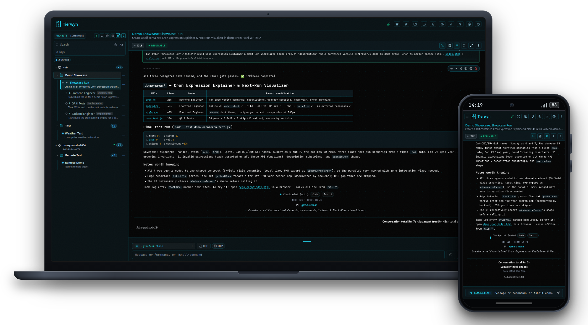

<p align="center">
  
</p>

# Tierwyn

*Tiers of agents.*

Tierwyn, said "TEER-win", is **a meta-harness for coding agents**. One browser UI for the agents you already run, at your desk or on your phone. Hand work across them and get every result back in a single conversation. Site: [tierwyn.dev](https://tierwyn.dev). GitHub: [tierwyn/tierwyn](https://github.com/tierwyn/tierwyn).

Tierwyn drives the agent CLIs you have installed and signed in to, so every model call goes through that CLI. It streams their output to the browser as one normalised event stream and keeps conversations in SQLite.

<!-- MEDIA: hero demo. Uncomment when docs/media/hero.gif exists (20-30 s loop, <8 MB).
     VIDEO_URL = GitHub user-attachments mp4 or YouTube link to the full walkthrough.
<p align="center">
  <a href="VIDEO_URL"></a>
  <br /><sub>▶ <a href="VIDEO_URL">Full 2-minute walkthrough</a></sub>
</p>
-->

| For | Not for |
|---|---|
| One person, self-hosted, on your own network | Multi-tenant SaaS |
| CLIs with real privileges on machines you own | A hosted sandbox |
| One command centre for many agent tools | A public HTTP API product |

**Not a hosted sandbox.** Agents run with your user privileges by default, with an optional per-process [bubblewrap sandbox](docs/architecture/sandbox.md) to isolate agent execution. Read **[SECURITY.md](SECURITY.md)** before exposing Tierwyn on a network.

## What it does

**Fifteen CLI agents behind one picker:** Claude Code, Codex, Cursor, Grok Build, Qwen Code, Kimi Code, OpenCode, Hermes, OpenClaw, KiloCode, Pi, GitHub Copilot, Antigravity, Kiro and DeepSeek, plus the Grok Bot desktop app. Each uses its own install and its own login.

- **Delegation you can watch:** agents spawn other agents (any CLI, any model); results come back into the parent conversation.
- **Scheduled jobs:** interval and cron runs, multi-step plans, pipelines.
- **Voice in and out:** dictation and text-to-speech (browser, Piper or Kokoro).
- **Server-side plugins:** web search/scrape, image, audio and more, callable by agents; credentials stay in the server vault.
- **Checkpoints and handoffs:** restore transcript and files per turn; resume past context limits.
- **Git without a terminal:** stage, diff, commit, branch, stash and worktrees from the UI.
- **Safe mode:** spawn approval and per-tool permission prompts for agents that support them.
- **Remote hosts:** run agents on your other machines through `tierwyn node`.
- **From your phone:** installable PWA with push notifications.
- Also: MCP servers, project memories, operator rules, a global task log, agent mesh messaging and a prompt collection.

**Full feature map:** **[docs/capabilities.md](docs/capabilities.md)** · **All docs:** **[docs/README.md](docs/README.md)**

## Screenshots

<p align="center">
  
  <br />
  <sub><b>Desktop workspace &amp; mobile PWA.</b> Projects, spawn tree, remote hosts, and live agent output on desktop and phone.</sub>
</p>

<!-- MEDIA: additional screenshots. Uncomment when the PNGs exist in docs/media/.
| | |
|---|---|
|  |  |
| **Many agents, one picker.** Claude Code, Codex, Cursor, Grok and more. | **Delegation.** Watch the spawn tree run across agents. |
|  | |
| **Scheduled jobs.** Interval and cron runs. | |
-->

## Install

One command. First run starts guided setup.

<!-- MEDIA: install recording. Uncomment when docs/media/install.gif exists (agg from install.cast, <5 MB).
     CAST_URL = asciinema.org recording or the tierwyn.dev install page with the live player.
<p align="center">
  <a href="CAST_URL"></a>
</p>
-->

**npx:**

```bash
npx tierwyn
```

**npm (global):**

```bash
npm install -g tierwyn
```

**curl:**

```bash
curl -fsSL https://raw.githubusercontent.com/tierwyn/tierwyn/main/scripts/install.sh | bash
```

With no existing install, all three do the same thing: clone the repo into `~/tierwyn` (set `TIERWYN_DIR` to override) and start guided setup. Afterwards, the `tierwyn` command (`~/.local/bin/tierwyn`) runs everything, so you don't need npx again. Missing Node? The curl path can install Node 24 LTS into `~/.local` for you (official tarball, checksum-verified, no sudo); npx and npm need Node up front.

Setup checks prerequisites, builds every workspace, configures a run mode (**dev** for localhost with no login, **prod** for password login on port 8788, or **dedicated hub**), detects and installs the agent CLIs you tick, then runs `tierwyn doctor`.

**Always-on hub:** give it a dedicated Unix user so agents can't rewrite the install (sandbox on by default in hub mode). Don't do this on the workstation where you develop. See **[docs/deploy/hub-user.md](docs/deploy/hub-user.md)**.

Common commands:

| Command | What it does |
|---|---|
| `tierwyn` | Interactive home |
| `tierwyn setup` | Full guided setup (alias: `install`) |
| `tierwyn doctor` | Diagnostics (exit 1 on failure) |
| `tierwyn status` | Services and sidecars at a glance |
| `tierwyn start\|stop\|restart [prod\|hub\|all\|piper\|kokoro\|grokbot]` | Service control (no target: the installed API + web pair) |
| `tierwyn hub start\|stop\|restart\|logs\|status` | Dedicated hub pair (`tierwyn-hub*`) |
| `tierwyn config` | Run mode (dev / prod / hub), port, password, units |
| `tierwyn update` | Update to the newest release (or `main` on edge) + rebuild + restart running services |
| `tierwyn channel [stable\|edge]` | Show or set the update channel: `stable` (default) follows release tags, `edge` follows `main`. Never downgrades. |
| `tierwyn logs [target]` | Follow service logs |
| `tierwyn agents` | Discover and install agent CLIs |
| `tierwyn linger` | Keep services running after logout (`sudo loginctl enable-linger`) |
| `tierwyn node …` | Remote-host daemon on another machine (see [remote hosts](docs/architecture/remote-hosts.md)) |

Full production walkthrough (TLS, systemd, env): **[docs/deploy/deployment.md](docs/deploy/deployment.md)**.

## Project status

Single-maintainer project. Issues are welcome. Pull requests are accepted at the maintainer's discretion. There is no `CONTRIBUTING.md`.

## Prerequisites

- **Linux** (systemd user session recommended)
- **Node.js 24 LTS recommended (22.13 minimum)**, **git**
- At least one supported **agent CLI** on `PATH` (e.g. `claude`)
- Optional:
  - Systemd user session (for background services)
  - Bubblewrap (`bwrap`, for agent sandboxing)
  - Piper / Kokoro sidecars for high-quality TTS
- For production LAN/remote access: a **TLS reverse proxy** (with WebSocket upgrade; see the [deploy guide](docs/guides/deploy-to-production.md))

## Quick start (development)

```bash
git clone https://github.com/tierwyn/tierwyn.git tierwyn
cd tierwyn

npm install
npm run build --workspace=packages/shared

cp .env.example .env
# Generate secrets for .env:
# SESSION_SECRET:
openssl rand -base64 32
# OPERATOR_PASSWORD_HASH:
node -e "import('argon2').then(a => a.hash('YOUR_PASSWORD')).then(console.log)"
# (or AUTH_DISABLED=true for local dev only; never in prod)

npm run dev
```

| Service | URL |
|---|---|
| Web (Vite) | http://localhost:5173 |
| API + WebSocket | http://localhost:8787 |

`npm run dev` starts both. Vite proxies `/auth`, `/profiles`, `/spawn`, `/ws`, etc. to the API.

First-run walkthrough with verification steps: **[docs/getting-started/README.md](docs/getting-started/README.md)**

```bash
npm run dev:server    # API only (8787)
npm run dev:web       # web only (5173)
npm run typecheck
npm run test --workspace=apps/server
npm run docs:check    # docs link + freshness harness
npm run build
```

## Monorepo layout

```
apps/server      Express API, WebSocket, SQLite, agent adapters
apps/web         React SPA (Vite)
packages/shared  types and protocol (build this first)
docs/            product docs (capabilities, architecture, deploy)
```

## Production (same machine)

Typical setup: API on loopback `:8788`, Vite preview on `:4173`, reverse proxy with **WebSockets** enabled.

The root `deploy:prod*` and `tierwyn:*` npm scripts are for Linux systems with a systemd user session.

```bash
npm run deploy:prod:full   # build all + restart API + web
npm run deploy:prod        # web-only rebuild + restart
```

- **[Deploy to Production (guide)](docs/guides/deploy-to-production.md):** systemd, env, TLS
- **[docs/deploy/deployment.md](docs/deploy/deployment.md):** LAN + TLS walkthrough
- **[docs/deploy/operator-sidecars.md](docs/deploy/operator-sidecars.md):** Piper / Kokoro systemd

## Documentation

| Doc | Contents |
|---|---|
| [docs/README.md](docs/README.md) | Documentation hub (index of every page) |
| [docs/getting-started/README.md](docs/getting-started/README.md) | Setup tutorial |
| [docs/capabilities.md](docs/capabilities.md) | Feature map for operators |
| [docs/troubleshooting.md](docs/troubleshooting.md) | Symptom → cause → fix |
| [docs/reference/configuration.md](docs/reference/configuration.md) | Environment variables |
| [SECURITY.md](SECURITY.md) | Threat model, spawn tokens, safe mode |
| [CLAUDE.md](CLAUDE.md) | Architecture, adapters, prod gotchas |
| [AGENTS.md](AGENTS.md) | Short guide for coding assistants |

## Licence

[MIT](LICENSE) © 2026 The Tierwyn Authors.

## Third-party licences

Tierwyn itself is MIT. `@anthropic-ai/claude-agent-sdk` is a proprietary runtime dependency (© Anthropic PBC, under [Anthropic's legal agreements](https://code.claude.com/docs/en/legal-and-compliance)). It is installed from npm and is not vendored. Do not redistribute `node_modules` or images that embed the SDK without checking their terms. Other dependencies are open-source licences.

TTS voices (Piper / Kokoro) download at runtime from Hugging Face under their respective individual licenses.

### Trademarks / not affiliated

Agent names (Claude, Codex, Cursor, Grok, Qwen, Kimi, GitHub Copilot, DeepSeek, etc.) are trademarks of their respective owners. Tierwyn is an independent open-source tool and is not affiliated with, sponsored by, or endorsed by them. Note that Grok Bot automation drives a third-party desktop app that the user installs themselves.
