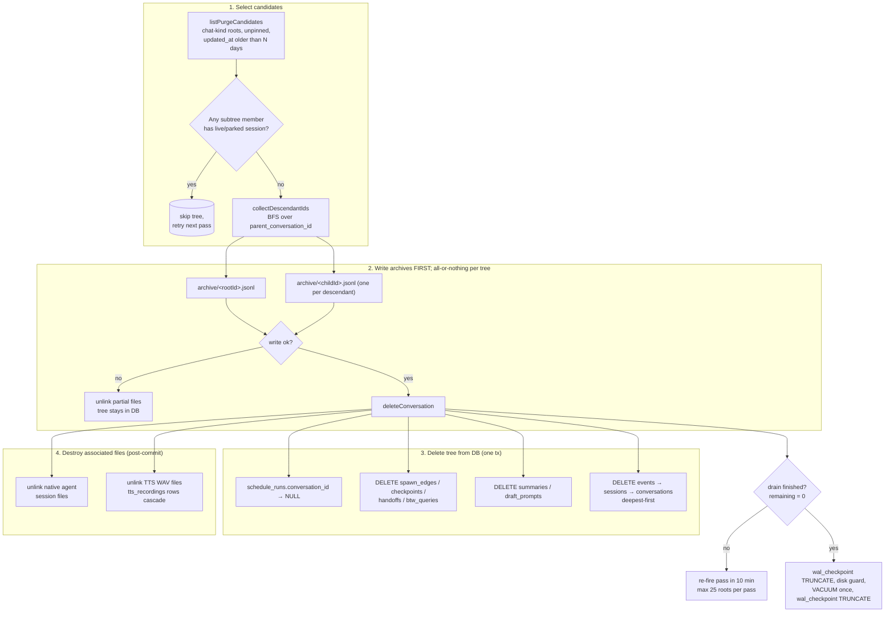
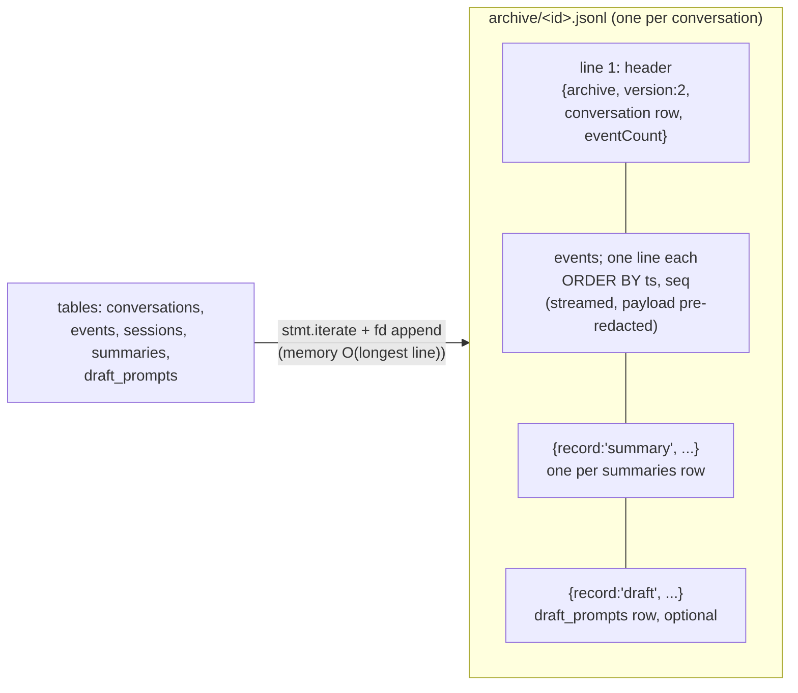
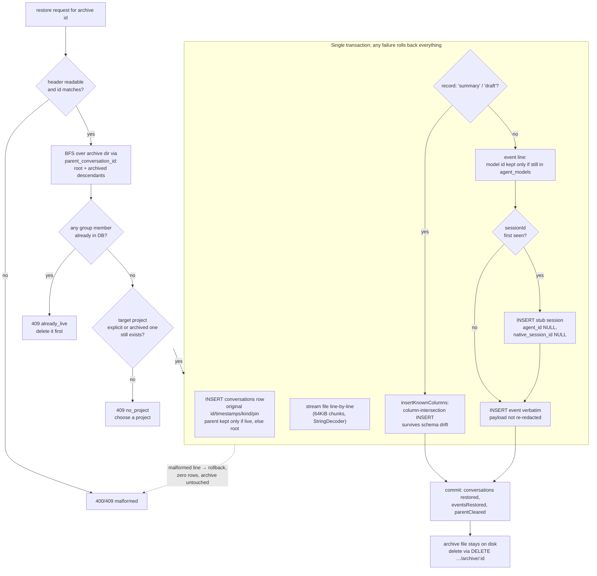

# Conversation retention

Nightly archive-then-delete of idle unpinned chat conversations.

| | |
|---|---|
| **Setting** | General → **Conversation Retention** (own section, immediately after Notifications) → days. Default **0** (keep forever). **0 disables.** |
| **Code** | `apps/server/src/repositories/retention.ts`, `startRetentionScheduler` in `apps/server/src/index.ts` |
| **Pin** | Root conversations only. Sidebar 📌 indicator + overflow Pin/Unpin. PATCH `/conversations/:id` `{ pinned: boolean }`: 400 on spawn children. |
| **Archive** | `data/archive/<conversationId>.jsonl` (v2). Not HTTP-servable (extension allow-list **and** explicit `archive/` path denial). |
| **Purge now** | Settings → General → Conversation Retention, shown only when days > 0. `POST /settings/retention/purge` runs the first pass immediately and continues the chunked drain. |

---

## Schedule

- Nightly at **~03:00 local** (`RETENTION_HOUR = 3`), as a self-rescheduling `setTimeout` chain (not `setInterval`).
- Boot never runs a pass, even with a backlog: VACUUM would freeze the hub right after a restart. A backlog waits for 03:00 (or **Purge now**). Chunked re-fires run **10 minutes** apart while `PurgeResult.remaining > 0`. A restart mid-drain resumes at the next 03:00.
- Each pass deletes at most **25** root conversations (`maxConversations`), yielding via `setImmediate` after each deletion so the event loop stays responsive on a large DB.
- `stop()` clears the current timer. Shutdown already calls it.

## Pin semantics

Pinned conversations are **never** selected by the purge. Pinning does **not** bump `updated_at` (bookkeeping, not activity). Pin is **root-only** (PATCH on a spawn child returns 400); children follow their root and are deleted with it when the root expires. Schedule homes (`kind = 'schedule_home'`) are excluded by kind, independent of pin.

## Archived conversations

`conversations.archived` is a soft-hide, distinct from the on-disk retention archive: an archived row drops out of the default sidebar list but stays live in the DB. The archive-box toggle in the sidebar header lists archived rows (the list endpoint takes `?includeArchived=1`, `repositories/conversations.ts:119`); Archive/Unarchive lives in the conversation overflow menu and the bulk action bar. API: `PATCH /conversations/:id` `{ archived: boolean }`.

Archived roots are **exempt from the purge**: `listPurgeCandidates` filters `AND (archived IS NULL OR archived = 0)` (`repositories/retention.ts:44`), so archiving preserves a conversation the retention clock would otherwise delete. Archiving does not stop the nightly scheduler; unarchived eligible trees still purge normally.

## Live / parked skip

A candidate is skipped if **any** member of its spawn subtree has a session in `sessionManager.activeSessions()`, that set includes parked hold-open sessions. Parked trees are conservatively kept; the next nightly pass retries. BTW children die with their root when the tree is eligible (accepted policy).

## Archive format (v2)

One `.jsonl` file per conversation in the tree (root and descendants). First line is a header:

```json
{
  "archive": "tierwyn-conversation",
  "version": 2,
  "conversation": {
    "id": "...",
    "title": "...",
    "project_id": "...",
    "kind": "chat",
    "parent_conversation_id": null,
    "pinned": 0,
    "created_at": 0,
    "updated_at": 0
  },
  "eventCount": 0
}
```

Following lines are events (`ORDER BY ts, seq`), then `summaries` rows (`{ "record": "summary", ... }`) and the `draft_prompts` row when present (`{ "record": "draft", ... }`). Writes are streamed (`stmt.iterate` + fd append); never buffered as a giant string. A write failure for any member of the tree aborts that tree (all-or-nothing); the conversations stay in the DB.

Archives are **not** served over `GET /files`. Two independent layers:

1. `jsonl` is not in `OPENABLE_EXTENSIONS`.
2. `isRetentionArchivePath` rejects any resolved path inside `<dataDir>/archive/` **before** the extension check. This holds even if `jsonl` (or `.md`) later becomes openable. The data dir *is* lexically inside registered project roots on this deployment; layer 2 is the real defense-in-depth, not a claim that `./data` is outside the allow-list.

`POST /settings/retention/purge` (operator session) kicks the same purge path as the scheduler: first pass immediately, then the 10-minute chunked re-fire chain until `remaining === 0`. A second call while a drain is in flight returns **409** `{ alreadyRunning: true }`. The request returns after the first pass; it does not wait for the whole drain.

## VACUUM

SQLite does not return pages to the OS on `DELETE`. After the **final** chunk of a drain (`remaining === 0` and at least one deletion), the pass runs `wal_checkpoint(TRUNCATE)`, checks free disk, runs `VACUUM` once, then runs `wal_checkpoint(TRUNCATE)` again (also when VACUUM fails). Intermediate 25-conversation chunks do **not** VACUUM (a full VACUUM freezes the process ~10–20 s on a 1 GB DB). All of it is skipped for `:memory:` (tests).

VACUUM writes a temp copy and then pushes the rewritten DB through the WAL, so the pass requires free space of at least **2.2× the DB size** on the DB's filesystem. Below that it logs a warning, sets `PurgeResult.vacuumSkipped`, and retries on the next drain that deletes something. A throwing VACUUM sets `vacuumFailed`; the DB stays intact and unshrunk. SQLite's temp file may live on another filesystem (`SQLITE_TMPDIR`, `TMPDIR`, `/var/tmp`, `/tmp`); that one is not checked, and running out there surfaces as `vacuumFailed`. `POST /settings/retention/purge` returns both flags when set.

`openDb` sets `journal_size_limit` to 128 MB so the WAL file is trimmed after a checkpoint resets it. It does not limit growth during a single transaction.

## 0 = disabled

`conversationRetentionDays = 0` means keep forever. The nightly timer still arms (so a later settings change takes effect) but `runRetentionPurge` is not invoked.

---

## Data-flow diagrams

### Archive → purge (nightly 03:00 or manual kick)

What is copied to disk, what is deleted from the DB, and which associated files are destroyed. **TTS WAVs and native agent session files are unlinked at purge and are never part of the archive**; they cannot come back on restore.



### Archive file contents (v2 JSONL)



**Not archived:** `sessions` rows (stubbed at restore), native session files, TTS WAVs, checkpoints, spawn_edges, handoffs, btw_queries.

### Restore (Settings → Retention → archive list)

`POST /settings/retention/archive/:id/restore`; replays JSONL back into the live DB with original ids. The archive file is **never consumed**: it stays on disk after a successful restore, so a second attempt returns 409 `already_live`.



### What comes back vs. what is gone forever

| Data | At archive time | After restore |
|---|---|---|
| conversations / events / summaries / draft_prompts | copied to JSONL, then deleted | re-inserted with original ids and payloads |
| sessions rows | deleted, **not archived** | re-stubbed from event references (no agent, no native id) |
| native agent session files | unlinked | **gone forever**: stub has NULL |
| TTS WAVs + `tts_recordings` rows | unlinked + rows deleted | **gone forever** |
| checkpoints / spawn_edges / handoffs / btw_queries | deleted, not archived | **gone forever** |
| schedule_runs references | `conversation_id` NULLed | stay detached |

Net effect: a restore yields a **readable transcript** with working parent/child links, not a **resumable agent session**. Restored conversations are historical records.
