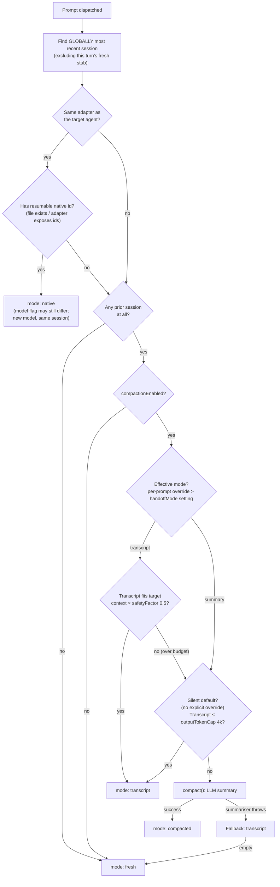
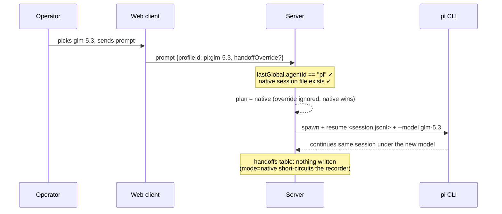
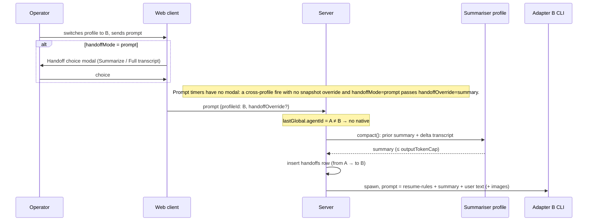
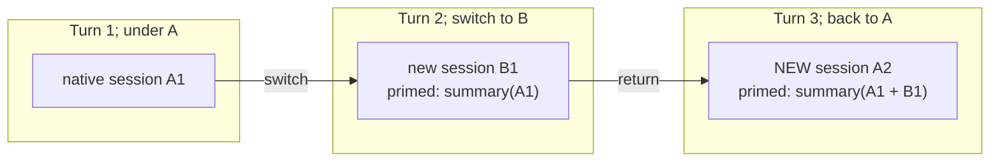
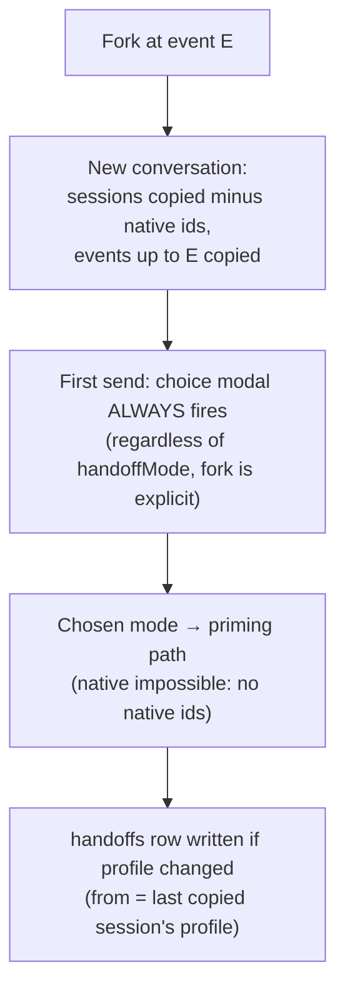
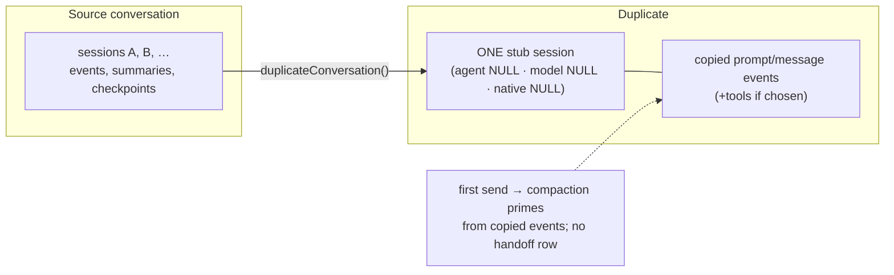
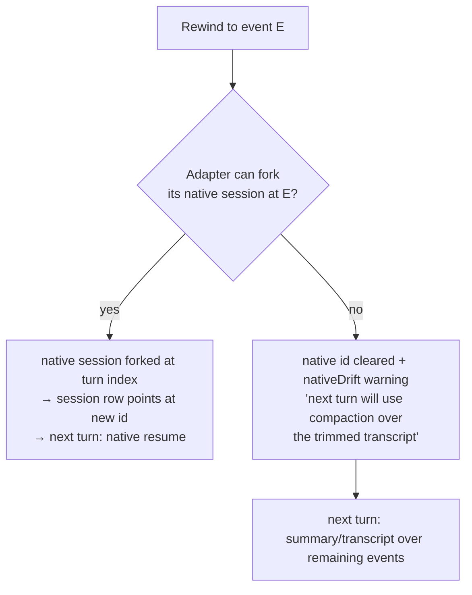
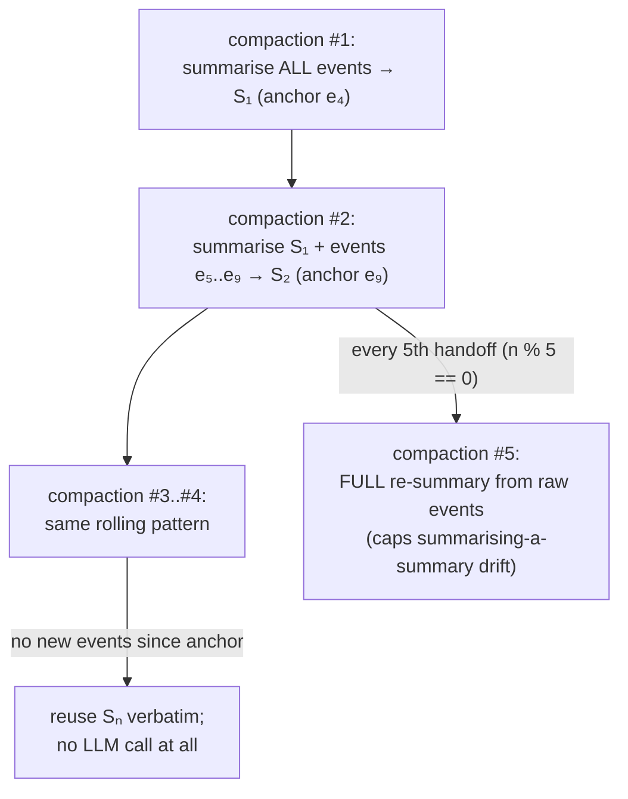

# Conversation Handoffs

How Tierwyn carries conversation context across turns, models, agents, forks,
duplicates, rewinds, and side questions, and how the summaries that power it
work. This is product architecture, not an API catalog.

| | |
|---|---|
| **Decision engine** | `buildResumePlan()` in `apps/server/src/compaction/compactor.ts` |
| **Summariser runner** | `apps/server/src/compaction/runner.ts` |
| **Transcript builder** | `apps/server/src/compaction/transcript.ts` |
| **Image re-attachment** | `apps/server/src/compaction/handoffAttachments.ts` |
| **Handoff records** | `handoffs` table (`repositories/handoffs.ts`), `GET /conversations/:id/handoffs` |
| **Rolling summaries** | `summaries` table (`repositories/summaries.ts`) |
| **Settings** | Settings → Compaction (`getCompactionSettings`, seeded defaults in `db/seed.ts`) |
| **Related docs** | [checkpoints.md](./checkpoints.md), [cross-agent-spawn.md](./cross-agent-spawn.md), [dictation.md](./dictation.md) |

---

## The four resume modes

Every prompt dispatch (`SessionManager.handlePrompt` / `handleCommand`) calls
`buildResumePlan()` **before** the adapter spawns. The plan is one of:

| Mode | Meaning | What the adapter receives |
|---|---|---|
| `native` | Prior turn's session belongs to the **same adapter** and its native session file still exists | `nativeSessionId`; the CLI resumes its own session (`--resume`, `switch_session`, …). Full fidelity, zero cost. |
| `transcript` | Prior history is replayed as a primed prompt built from the **raw transcript** | `primingPrompt` (verbatim history) + re-attached images |
| `compacted` | Prior history is folded into an **LLM-written summary** and primed | `primingPrompt` (summary) + re-attached images |
| `fresh` | Nothing to carry (first turn, no history, or compaction disabled) | Nothing; the prompt goes through as typed |

## Switch choice modal & session reset (override semantics)

Sending under a different profile than the last turn (with prior history) **always** opens one
modal, regardless of `handoffMode`. Cards: **Continue same session** (same agent, resumable, and
the adapter applies the new model on resume: `MODEL_SWITCH_RESUME_ADAPTERS`), **New session**,
**Hand off · Summary**, **Hand off · Full transcript** (the last two are narrowed by a fixed
`handoffMode`). Cancel aborts the send. The prompt `+` menu also stages **New session** or
**Handover (summary)** as a pinned badge applied on the next send (disabled while a turn runs, in
Remote Agents chats, and for grok-bot).

`handoffOverride` is `'summary' | 'transcript' | 'fresh'`; *Continue* is simply **no override**.

| override | `buildResumePlan` |
|---|---|
| undefined | native if same agent + available, else per `handoffMode` |
| `fresh` | `{ mode: 'fresh' }`; no native resume, no priming (transcript stays in Tierwyn) |
| `summary` / `transcript` | Skips native resume (when compaction is enabled); ignored if compaction is disabled, then native resume still applies (see [compaction-resume.md](./compaction-resume.md) for details) |

An override never steers into a live turn (the live session is stopped first) and is never replayed
by the queued-follow-up drain. Same-profile overrides still write a `handoffs` row (`fresh` →
`requested_mode='fresh'`, `resolved_mode='fresh'`), rendered as a "New session" / "Handover" divider.
`parent_message` and timer wake-ups only default to a summary override on cross-**agent** switches.

## The decision flow



**Three load-bearing subtleties:**

1. **The native check uses the globally-most-recent session, not the most
   recent for this adapter.** This is what makes `A → B → A` behave
   correctly; see [Returning to the original agent](#a--b--a-returning-to-the-original-agent).
2. **Model change within one agent is still `native`.** A new model flag is
   passed to the resumed session; only the *adapter* (agent type) matters for
   the native/compaction split.
3. **`compactionEnabled = false` does not disable native resume**: it only
   blocks the summary/transcript paths. Disabling compaction never costs you
   same-adapter continuity.

---

## Scenario catalog

### Same profile, next turn (the common case)

Adapter X resumed natively; no handoff machinery runs, no summary is written,
no `handoffs` row is recorded. The transcript UI replays from the `events`
table as always.

### Model change within the same agent (e.g. Pi glm-5.2 → glm-5.3)



- **Server side:** with no override, native when the prior session belongs to the same
  adapter; the model is simply swapped in `adapter.start()`. An explicit
  `handoffOverride` (modal choice) **skips** native resume.
- **Client side:** the choice modal keys off the **profile id**, so Claude Sonnet → Claude Opus
  (same agent) pops it with a *Continue same session* card (no override → native).
- **`handoffs` row:** no on *Continue*: `recordHandoff` returns immediately
  on `mode: 'native'`.

### Cross-agent switch (A → B): "when we switch, we summarize"



The prompt the new agent receives is prefixed with the **resume rules** block
("You are resuming mid-conversation, not starting fresh…"), which is exactly
the same block you see at the top of delegated conversations; see
[cross-agent-spawn.md](./cross-agent-spawn.md) for how spawned children get
their handoff files.

**Bare-prompt adapters** (`BARE_PROMPT_ADAPTERS`, today `grok-bot`) never get a
spawn/schedule preamble or Bearer. Handoff priming (plus a Hostname +
conversation-CWD note) is gated by Settings → Grok Bot → **Allow in project
chats** (`grokBotInProjectChats`, default off). On a grok-bot spawn child the
bare-child host/CWD/RESULT note precedes that priming host note. When that flag is off, Grok Bot
profiles are hidden from normal project pickers and the server rejects
grok-bot prompts outside the Grok Bots (Remote Agents) project; Remote Agents
conversations still receive priming when a ResumePlan produces one.

### A → B → A (returning to the original agent)

The trap this design avoids: naively "resuming A's native session" here would
silently drop every turn B produced. Because the decision engine looks at the
**globally** most recent session (which is B's), `sameAgent` is false and the
plan falls through to compaction; the returning A instance gets a **fresh
session primed with a summary that includes B's turns**.



A handoffs row is recorded for both switches (`A→B` and `B→A`).

### Prior session has no native id (or the file vanished)

Happens when: the adapter never reported a session id, the session file was
deleted on disk, or the prior session row is a stub (see duplicates below).
Same-agent or not, native is impossible → summary/transcript path. If the
profile also changed, a handoffs row is recorded; same profile → no row.

### Transcript handoff and the budget fallback

When the effective mode is `transcript` (setting, or modal choice, or the
fork first-send modal), the built transcript must fit the **target model's
context window** (resolved live from the adapter's `listModels()`, ×
`transcriptContextSafetyFactor`, default 0.5). Unknown window (e.g. adapters
that advertise none) = `Infinity`, so the fallback can't misfire. Over budget
→ falls through to the summary path.

### The silent summary default & the short-history shortcut

With the default `handoffMode: 'summary'` and **no** explicit modal override,
the server first estimates the (tool-IO-compacted) transcript: if it's no
bigger than `outputTokenCap` (4k tokens), summarising can't shrink it, so the
transcript is passed verbatim; no summariser call, no latency, no cost.
Resolved mode is still recorded as `transcript`, which the UI surfaces as the
mismatch hint *"Short history passed verbatim (no summarizer run)."*

### Summariser failure

`compact()` throws (summariser profile unreachable, auth expired) → fallback
summariser profile → still throws → transcript fallback → empty transcript →
`fresh`. A failed handoff never blocks the prompt; it only degrades context.

### Fork at event (transcript branch)

**UI:** event context menu → *Fork from here*. `forkConversation()` copies
the conversation row, all sessions, and all events up to the anchor; with
`native_session_id` **deliberately stripped** from the copied session rows
(a fork must not resume the original's live session). `agent_model_id` is
kept, so the fork "remembers" which profiles produced it.



### Duplicate conversation (snapshot copy)

**UI:** conversation actions → *Duplicate* (options: prose-only or with tool
trail). Unlike a fork this is a **root chat**, not a branch: the whole
transcript (filtered event types only) is re-inserted through `appendEvent`
(redaction + FTS indexing re-apply for free) into **one NULL-everything stub
session**; no agent, no model, no native id.

Consequences for handoff:

- First prompt in the duplicate can never be native → summary/transcript
  path over the copied events.
- **No handoffs row is recorded** for that first turn: the recorder needs
  `lastGlobal.agentModelId`, which the stub doesn't have.
- No modal fires (no fork flag); the global `handoffMode` decides.
- `summaries`, `handoffs`, checkpoints and spawn edges are **not** copied:
  the duplicate starts with a clean slate and pays for one fresh compaction.



### `/btw`: one-shot side question

`/btw <question>` (or the BTW control) answers a question *about* the live
conversation via the sidecar `btw` site. There is no child conversation and
no spawn token. The **answerer** runs read-only (Read/Glob/Grep, cwd-scoped),
tools-off, or a plain Direct LLM call. The **priming summariser** is also
tool-free (`toolFreeOnly`: oneShot `'none'` or a `textOnly` session on
claude-code; any other adapter is rejected and the plan falls
back to a capped transcript). Neither leg can start a mutating agent session.

```mermaid
sequenceDiagram
    participant U as Operator
    participant W as Web client
    participant S as Server (btw route)
    participant P as Parent conversation
    participant R as sidecar (read-only oneShot)

    U->>W: /btw what does this fn do?
    W->>S: POST /conversations/:id/btw
    S->>P: insert btw row (status=asking)
    S-->>W: 200 {id}  ← responds before priming
    Note over S: detached job:
    S->>P: buildResumePlan; observer framing,<br/>never native (agentId 'btw' + isNativeAvailable=false),<br/>skipPersist=true, inflight events cut to<br/>last completed boundary, body capped to btw.maxInputChars
    S->>R: sidecarComplete('btw', priming + question)
    R-->>S: prose answer
    S->>P: btw row completed (answer, model) → btw_updated frame
```

Handoff specifics that differ from a normal switch:

- **Never native**: `agentId: 'btw'` (not an adapter id, so `sameAgent` is
  false) plus `isNativeAvailable: async () => false`.
- **Transcript override**: `override: 'transcript'` so the BTW sees the
  conversation including tool calls/results when the transcript fits the
  sidecar budget (`compactToolIo` is off on this path). Over-budget falls
  through to question-aware compaction; if the summariser is rejected
  (`toolFreeOnly`), a capped transcript is still used. Compaction-disabled
  installs with parent events also get an observer-framed transcript instead
  of empty `fresh`.
- **`skipPersist: true`**: the summary is computed but never written to the
  parent's `summaries` table, so BTW can't corrupt rolling-summary
  bookkeeping.
- **Observer framing**: priming uses `BTW_OBSERVER_RULES` instead of
  `HANDOFF_RESUME_RULES`. The model is told it is not the continuation agent
  and must not carry out the parent's task. The behaviour contract
  (`BTW_DIRECTIVE`) is the sidecar site's builtin system prompt.
- **Question-aware priming** (`primingMode: 'question-aware'`): the
  summariser gets a focus block instructing it to bias towards information
  relevant to the question.
- **In-flight truncation:** if the parent turn is mid-stream, its events are
  included only up to the last *completed boundary* (tool result, file
  change, or final message); never a half-streamed chunk.
- **Timeout** is the sidecar `btw` site's `timeoutSecs` (documented fallback
  240 s, clamped 5–600). There is no hard-timeout / grace / stall watcher
  and no `BTW_FORCE_TIMEOUT_MS`. Worst-case wall time in `asking` is priming
  (up to 2 × 120 s for preferred + fallback summariser) plus the answer
  timeout (~480 s).
- **Fork:** `POST /conversations/:id/btw/:btwId/fork` copies the parent
  transcript (including tool calls/results) up to the BTW's `createdAt`, then
  appends the question and answer as ordinary prompt/message events. The new
  conversation is a **root** chat (no `parent_conversation_id`), matching
  Duplicate / the old Fork behaviour, so deleting or retaining the parent
  never deletes the operator's fork. Title is prefixed `BTW:`. Idempotent
  while the fork still exists.

### Rewind / checkpoint restore

Rewinding truncates events after the anchor. Whether the next turn is native
depends on the adapter's `rewindNativeSession` support:



See [checkpoints.md](./checkpoints.md) for the restore-choice modal
(transcript-only / transcript+files / files-only).

### Spawned child agents

Children do **not** inherit the parent transcript. Their "handoff" is the
delegation file + roster written by the spawner; a different mechanism,
documented in [cross-agent-spawn.md](./cross-agent-spawn.md). Mentioned here
only to disambiguate: *conversation* handoffs (this doc) are about switching
profile/agent **within one conversation**.

---

## How the summary itself works

### Rolling summaries (one per compaction)

Each `compact()` run writes a `summaries` row keyed to the **last event id it
covers**. The next compaction only summarises *events after that anchor*
folded into the prior summary; cheap deltas, not full re-reads.



- **Nothing new since the last anchor** → the prior summary is returned
  unchanged; no summariser call.
- **Every 5th compaction** (`FULL_RESUMMARY_EVERY`, hardcoded) is rebuilt
  from raw events to bound drift.
- **Anchor pruned** (event gone, retention, rewind) → falls back to a full
  transcript summarisation.

### The summariser prompt

Fixed skeleton + `summaryVerbosity` hint (low = 5–8 bullets / medium =
1–2 paragraphs / high = thorough). The prompt instructs the model to:

- prioritise the **current state** over retrospective recap; task in
  progress, last error, hypothesis under test;
- quote the user's most recent message **verbatim**;
- preserve any question the user asked that the agent left unanswered;
- stay under `outputTokenCap`;
- **not** use tools or read files; summarise only the inline transcript
  (the transcript is pre-truncated to `maxCompactorContextTokens`, 100k).

### Summariser profiles & failure order

| Situation | Primary | On throw |
|---|---|---|
| Normal compaction | `compaction.preferredProfileId` (default `claude-code:sonnet-4.6`) | `fallbackProfileId` (default `claude-code:opus-4.8`) → then transcript fallback |
| `/btw` with priming override | BTW priming profile | `fallbackProfileId`: **not** the preferred profile: an explicit override honours the failure rather than silently switching summarisers |

### Priming delivery

The chosen body (transcript or summary) is wrapped as:

```
[intro; resuming, here is a transcript/summary]
[N image(s) attached; use as visual context]   ← only when images exist
HANDOFF_RESUME_RULES ("You are resuming mid-conversation…")
<body>
```

`/btw` uses the same funnel with `framing: 'observer'`: no image note, no
resume rules, `BTW_OBSERVER_RULES` instead, and the body is capped to
`btw.maxInputChars` *before* the UNTRUSTED wrapper.

then `capForArgvSpawn()` trims from the front (keeping the most recent tail)
if it exceeds ~400 KB; adapters that pass the prompt as a CLI positional
(cursor-agent, opencode, agy `--print`) would otherwise hit Linux `E2BIG`.

**Images:** transcripts and summaries can't carry binary, so image
attachments from prior user prompts in the handoff window are re-attached to
the priming message (image MIME only, deduped by content, max 20,
chronological) plus the current prompt's own attachments. Native resume
attaches none; the images already live in the adapter's own session.

---

## The `handoffs` table (audit trail)

Written by `recordHandoff()` after every plan resolution.
A row exists **iff** all of:

1. plan mode ≠ `native`,
2. a prior session exists,
3. that session has a profile (`agent_model_id`, stubs/duplicates don't),
4. from-profile ≠ to-profile, **or** an explicit `handoffOverride` was set (same-profile reset/handover).

Fields: `from_profile_id` / `to_profile_id`, `requested_mode`
(summary | transcript | fresh, what the setting, modal or `+` menu asked for), `resolved_mode`
(compacted | transcript | fresh, what actually happened),
`anchor_event_id` (last event before this turn's prompt, the badge in the
timeline), `summary_id` (link into `summaries` when compacted), and
`priming_context` (the exact block injected).

**Mismatch hints** (`handoffMismatchHint`) explain divergence in the UI:

| requested | resolved | Hint |
|---|---|---|
| transcript | compacted | "Transcript was too large; summarized instead." |
| summary | transcript | "Short history passed verbatim (no summarizer run)." |

---

## Settings reference (Settings → Compaction)

| Key | Default | Effect |
|---|---|---|
| `compactionEnabled` | `true` | `false` blocks summary/transcript handoffs (native still allowed) |
| `handoffMode` | `'summary'` | `'summary'` \| `'transcript'` \| `'prompt'` (ask per switch via modal) |
| `preferredProfileId` | `claude-code:sonnet-4.6` | summariser profile |
| `fallbackProfileId` | `claude-code:opus-4.8` | summariser fallback |
| `summaryVerbosity` | `'medium'` | `low` \| `medium` \| `high` hint |
| `outputTokenCap` | `4000` | summary size cap; also the passthrough threshold |
| `maxCompactorContextTokens` | `100000` | transcript fed to the summariser |
| `maxTranscriptHandoffTokens` | `150000` | transcript handoff build cap |
| `transcriptContextSafetyFactor` | `0.5` | transcript must fit target window × this |

BTW priming, timeout, and the answering model live on the sidecar `btw` site
(Settings → Sidecar LLMs → BTW side question), including `primingMode` and the
optional priming-profile override.

**Debug endpoint:** `GET /conversations/:id/resume-plan` shows the plan the
next turn would get, but note it is **not idempotent**: on the compacted
path it burns a real summariser call and persists a summary row. Do not wire
it into polling UIs.

---

## Quick scenario → outcome table

| Scenario | Plan mode | Handoffs row | Modal (prompt mode) |
|---|---|---|---|
| Same profile, next turn | `native` | no | no |
| Same agent, different model | `native` | no | yes (profile id changed); choice ignored by server |
| A → B switch | `compacted`/`transcript` | yes (A→B) | yes |
| A → B → A return | `compacted` (never native) | yes (B→A) | yes |
| Same agent, native file gone | `compacted`/`transcript` | only if profile changed | only if profile changed |
| First turn of conversation | `fresh` | no | no |
| `compactionEnabled=false` + cross profile | `fresh` | yes | yes (choice ignored) |
| First send after fork | `compacted`/`transcript` | yes if profile differs from copied last session | always (fork rule) |
| First send in a duplicate | `compacted`/`transcript` | no (stub has NULL profile) | no |
| `/btw` | never native; `compacted`/`transcript`/`fresh` | no (separate btw table) | n/a |
| After rewind | `native` if session forked, else `compacted`/`transcript` | only if profile changed | only if profile changed |
| Summariser dead | `transcript` → `fresh` | as per resolved mode | n/a |
