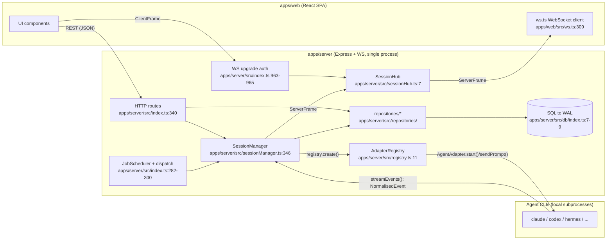
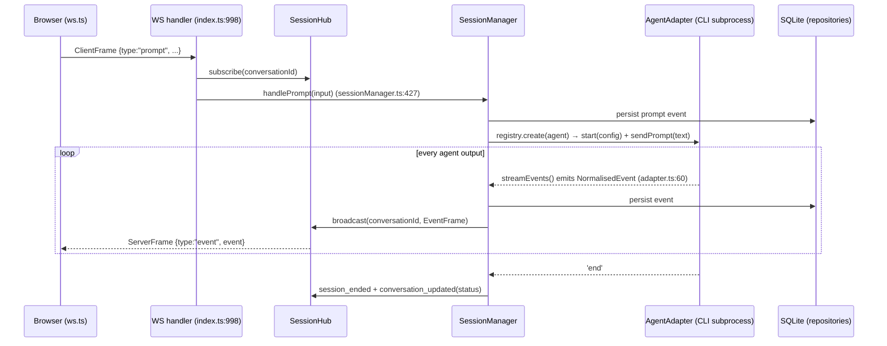
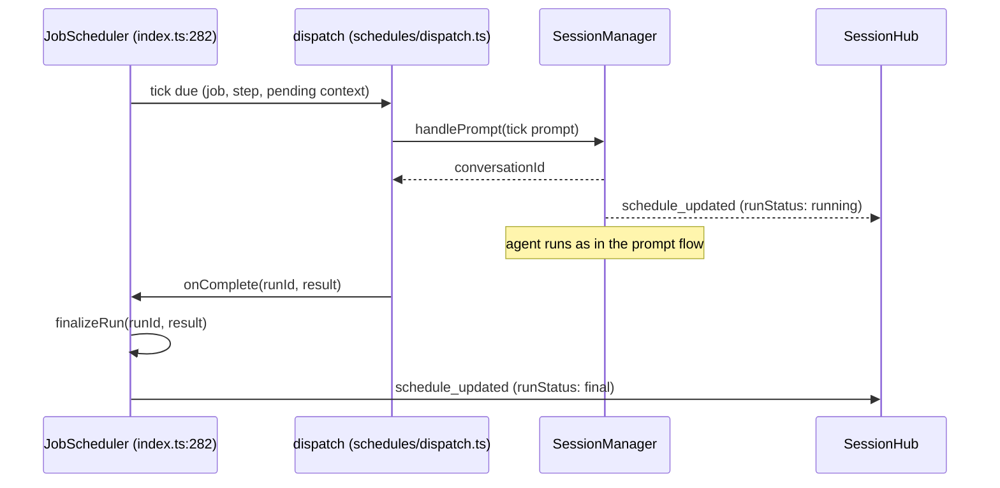
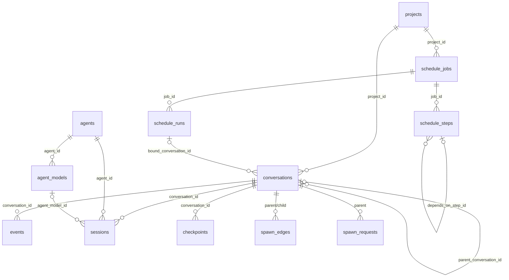

# System Architecture

How Tierwyn is put together: the pieces, how a prompt moves through them, and the
domain model underneath. Every claim here carries a `path:line` reference to the
code it was derived from; this page is re-derived from source, not paraphrased
from older docs.

Tierwyn is a single-user web UI + API server that drives multiple AI coding
agents (Claude Code, Pi, OpenCode, Antigravity, Cursor, Hermes,
Codex, Grok Build, Kiro, Qwen Code, Kimi Code, OpenClaw, GitHub Copilot, and
the KiloCode variant of OpenCode) from a browser. It spawns each agent's local CLI as a subprocess; there is no vendor
model API and no Anthropic API key anywhere in the server
(`apps/server/package.json:16-29`; the only agent SDK dependency is
`@anthropic-ai/claude-agent-sdk` at `apps/server/package.json:17`, which wraps
the local `claude` CLI).

## The three workspaces

The repo is an npm-workspaces monorepo (`package.json:12`):

| Workspace | Package | Role |
|---|---|---|
| `apps/server` | `@tierwyn/server` | Express REST + WebSocket server, agent adapters, SQLite persistence, schedulers (`apps/server/src/index.ts:340`, `:958-965`) |
| `apps/web` | `@tierwyn/web` | React SPA (Vite); dev server on 5173, prod preview on 4173 (`apps/web/vite.config.ts:27`, `:30`) |
| `packages/shared` | `@tierwyn/shared` | The contract boundary: event, protocol, adapter, and domain types both sides compile against (`packages/shared/src/index.ts:1-19`, 19 re-exported modules) |

`@tierwyn/shared` is the only package the other two both depend on; it is built
first.

## Component map

Key server-side pieces, all constructed in one boot sequence
(`apps/server/src/index.ts`):

1. `loadEnv` runs before anything else (`apps/server/src/index.ts:1`).
2. Auth config loads and fails fast: with no secrets the server boots
   **fail-closed**: every protected route and the WS upgrade are rejected
   (`apps/server/src/index.ts:106-125`, `apps/server/src/auth/config.ts:27-35`).
3. SQLite opens (`TIERWYN_DB`, prod default `./data/prod.db`), migrations run, seeds apply
   (`apps/server/src/index.ts:135-142`).
4. The catalogue loads and all 16 adapter types (15 CLIs + the Grok Bot desktop app) register into one
   `AdapterRegistry` (`apps/server/src/index.ts:155-195`,
   `apps/server/src/registry.ts:11-47`).
5. Model discovery, `SessionManager`, `JobScheduler`, and the nightly retention
   scheduler start (`apps/server/src/index.ts:194`, `:215-277`, `:282-311`,
   `:318-337`).
6. Express mounts routes; public health/auth first, then dual-auth
   spawn/schedule-agent routes, then the cookie-gated bulk
   (`apps/server/src/index.ts:356-385`).
7. HTTP + WS listen; after bind, `PORT`/`HOST` are deleted from `process.env`
   so agent subprocesses cannot re-bind the server's port
   (`apps/server/src/index.ts:1155-1171`).

## Life of a prompt

A prompt travels browser → WebSocket → SessionManager → adapter subprocess →
normalised events → back out to every subscribed client, and into SQLite:

Client frames are a closed union: `prompt`, `command`, `subscribe`,
`stop`, `steer`, `cancel_steer`, `edit_steer`, `interaction_response`,
`ping`, `stop_helper` (`packages/shared/src/protocol.ts`). Server frames are
a closed union defined alongside them in `packages/shared/src/protocol.ts`.
Everything an agent produces is a `NormalisedEvent`; an 11-variant union
(`prompt`, `message`, `tool_call`,
`tool_result`, `file_change`, `status`, `error`, `steer`,
`interaction_request`, `interaction_resolved`, `helper`) defined in
`packages/shared/src/events.ts`.

Delivery is two-tier (`apps/server/src/sessionHub.ts:7-57`):
`sessionHub.broadcast(conversationId, frame)` reaches sockets subscribed to that
conversation (`:44-48`), while `broadcastAll` / `fanOpenClients` reach every
connected operator socket for global signals like `conversation_updated`,
`schedule_updated`, and `session_started`/`session_ended`
(`apps/server/src/index.ts:200-276`).

Mid-run operator input rides the same socket: `steer` frames either inject into
the live turn or queue as a follow-up (`SessionManager.steerSession`,
`apps/server/src/sessionManager.ts:1273`); `interaction_response` answers a
permission/question request the adapter raised
(`apps/server/src/sessionManager.ts:1661`).

## Life of a scheduled tick

`JobScheduler` polls and fires jobs; each tick dispatches a prompt into a
conversation through the same `SessionManager` path, then finalises the run:

Details: [scheduled-jobs.md](scheduled-jobs.md) (engine and step transitions),
[schedule-packs.md](schedule-packs.md) (pack bundles),
[agent-schedule-discoverability.md](agent-schedule-discoverability.md).

## Domain model

The baseline schema (`apps/server/src/db/migrations/001_baseline.sql`) holds
every table. The core spine and its foreign keys:

Foreign-key sources (all in `001_baseline.sql`): `projects → conversations`,
`conversations → events`, `sessions`, `checkpoints`, `spawn_edges`,
`spawn_requests`, self-parent, `schedule_jobs`, `schedule_runs`, `schedule_steps`.

The transcript is append-only `events` rows keyed by `session_id`
(`001_baseline.sql`); conversations are the unit of UI, retention,
archiving, and spawn parentage. Every mutation flows through the repositories
layer (`apps/server/src/repositories/`), which is the only code that touches
the database handle installed at boot (`apps/server/src/db/index.ts:15-22`).

## Where to go deeper

| Subsystem | Page |
|---|---|
| Adapter command/skill discovery | [command-discovery.md](command-discovery.md) |
| Token usage & compaction | [agent-usage.md](agent-usage.md) |
| Browser notifications | [browser-notifications.md](browser-notifications.md) |
| Checkpoints & rewind | [checkpoints.md](checkpoints.md) |
| Git working tree panel | [git-working-tree-panel.md](git-working-tree-panel.md) |
| Conversation descriptions | [conversation-descriptions.md](conversation-descriptions.md) |
| Retention lifecycle | [conversation-retention.md](conversation-retention.md) |
| Cross-agent spawn & token caps | [cross-agent-spawn.md](cross-agent-spawn.md) |
| Dictation (Whisper) | [dictation.md](dictation.md) |
| Handoffs | [handoffs.md](handoffs.md) |
| Model discovery | [model-discovery.md](model-discovery.md) |
| Prompt collection | [prompt-collection.md](prompt-collection.md) |
| Schedule packs | [schedule-packs.md](schedule-packs.md) |
| Scheduled jobs engine | [scheduled-jobs.md](scheduled-jobs.md) |
| Agent schedule discoverability | [agent-schedule-discoverability.md](agent-schedule-discoverability.md) |
