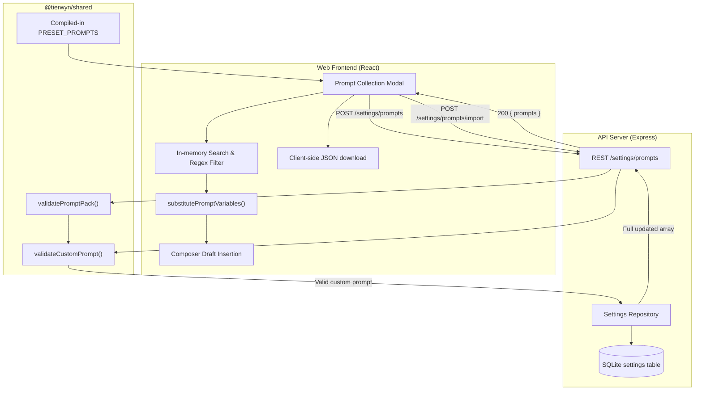

# Prompt Collection & Presets

Tierwyn includes a built-in library of high-leverage agent prompts (presets) and allows operators to create, edit, enhance, and manage custom prompts across sessions.

**Code:** `packages/shared/src/promptCollection.ts`, `packages/shared/src/promptPack.ts`, `apps/server/src/repositories/settings.ts`, `apps/server/src/routes/settings.ts`, `apps/web/src/components/PromptCollectionModal.tsx`, `SavePromptModal.tsx`, `PromptEnhanceModal.tsx`, `PromptPreviewModal.tsx`, `PromptVariablesModal.tsx`, `apps/web/src/promptSearch.ts`, `apps/web/src/promptInsert.ts`, `apps/web/src/promptPackFile.ts`

---

## What you see

| Surface | Description |
|---|---|
| **Chat input toolbar** | Prompt collection book icon opens the catalog modal |
| **Prompt collection modal** | Searchable list of all built-in presets and custom prompts with tags (`preset` / `custom`), live preview, edit, copy, and insert |
| **Save prompt modal** | Save current draft or selection as a new custom prompt (name, description, body) |
| **Enhance prompt modal** | AI-assisted prompt enhancement (`✨`) with variable instructions |
| **Prompt preview modal** | Fullscreen markdown preview of the prompt instructions before insertion |
| **Prompt variables modal** | Collect values for `{{name}}` tokens before insert or enhance |
| **Import prompts sub-modal** | File picker + paste textarea; client-side preview of a prompt pack, then `POST /settings/prompts/import` |

---

## Architecture & Data Flow



---

## Built-in Presets vs Custom Prompts

| Feature | Built-in Presets (`origin: 'preset'`) | Custom Prompts (`origin: 'custom'`) |
|---|---|---|
| **Storage** | Compiled in `@tierwyn/shared` (TypeScript) | SQLite `settings` table (`key = 'prompt_collection'`) |
| **Mutability** | Read-only (can be cloned/copied into custom) | Full CRUD (create, edit, delete, enhance) |
| **ID Format** | Static string (`preset-<slug>`) | Random UUID or custom string (cannot start with `preset-`) |
| **Availability** | Available immediately without DB or server dependency | Loaded via `/settings/prompts` REST API |

**Hiding presets:** the General settings toggle *Hide built-in prompts* (`hidePresetPrompts` in the
`general` settings blob) removes built-in presets from the modal listing and hides the *Presets*
origin chip. Custom prompts are unaffected. The modal reads the setting itself via
`GET /settings/general` on open.

---

## Built-in Presets Catalog

| Preset ID | Name | Core Focus & Guardrails |
|---|---|---|
| `preset-code-review` | Code review this diff | Correctness, contracts, concurrency, security. Worst-first findings (`severity, file:line, issue, fix`). Report only. |
| `preset-explain-codebase` | Explain this codebase | Grounded exploration: build/run, entry points, one end-to-end traced flow, data model, conventions, sharp edges. |
| `preset-write-tests` | Write tests | Match existing repo style, contract-first, boundary cases, provably failing tests, zero flaky sleeps/timers. |
| `preset-debug` | Debug systematically | Reproduce, reduce, binary-search path, test one falsifiable hypothesis at a time, fix root cause. |
| `preset-refactor` | Refactor safely | Behavior-preserving cleanup in small atomic moves, pinned by tests before and after. |
| `preset-commit-message` | Write a commit message | Diff-grounded conventional commit subject (≤72 chars) and body explaining why, check atomicity. |
| `preset-pr-description` | Write a PR description | Summary, motivation, approach, testing evidence, risk/rollback, and reviewer focus areas. |
| `preset-security-review` | Security review | Adversarial source-to-sink pass: injection, authz/authn, secrets, crypto, SSRF, TOCTOU races, data exposure. |
| `preset-document` | Document this module | Audience-first documentation (mental model, public API, invariants, failure modes, real usage example). |
| `preset-fix-failing-test` | Fix a failing or flaky test | Determine if test or code is wrong; characterize flakes across runs; fix cause without weakening assertions. |
| `preset-find-regression` | Find when this broke | Deterministic check, bound and bisect history (`git bisect run`), explain mechanism of flip. |
| `preset-performance` | Investigate performance | Define metric, baseline realistic workload, profile with tools, optimize dominant cost (Amdahl's law). |
| `preset-dependency-upgrade` | Upgrade a dependency safely | Sweep breaking changes per major hop, map the blast radius before editing, upgrade coherently, verify, list manual checks. |
| `preset-compare-approaches` | Compare two approaches | Concrete criteria, ground in codebase, evaluate build vs maintenance cost, commit to single recommendation. |
| `preset-write-feature-spec` | Write a spec for a new feature | Behaviour, constraints and "done when"; a spec file, not an implementation plan. `{{grill}}` empty/none skips the interview; yes/grill-me interviews one question at a time before writing. |
| `preset-orchestrate-pipeline` | Orchestrate plan → build → review | Three-stage delegation (planner, implementer, adversarial reviewer) from the roster; the orchestrator judges every handoff. |
| `preset-orch-add-feature` | Orchestrate adding a feature | Feature-shaped pipeline: scope integration points and house conventions, plan, build with gates and a minimal diff, adversarial review for missing requirements and regressions. |
| `preset-adversarial-review` | Spawn an adversarial reviewer | Delegate a disprove-it review of finished work to fresh eyes; findings with evidence, triaged, ship / do-not-ship verdict. |
| `preset-roster-survey` | Survey the delegate roster | Enumerate every spawnable role with its used-when description verbatim, note operating limits, recommend a staffing. |
| `preset-land-branch` | Land this branch on main | Survey branch divergence, integrate cleanly (merge/squash/rebase), verify tests, clean working tree. |
| `preset-docs-sync` | Bring the docs up to date | Map the docs structure, diff its claims against the code as it is now, update stale pages and fill real gaps in place; never reorganise; run the docs gate. |

Most shipped presets expose variables (collected in the fill modal before insert). `preset-code-review`, `preset-commit-message`, `preset-security-review` and `preset-explain-codebase` are deliberately flat so insert stays one click. Any preset can gain a `{{token}}` by editing its compiled body string; the parser is origin-agnostic.

**Orchestration tag:** presets that delegate to other agents rather than doing the work themselves carry the tag **`orchestration`**. New ones take the `preset-orch-*` id prefix; current members are `preset-orchestrate-pipeline`, `preset-orch-add-feature`, `preset-adversarial-review` and `preset-roster-survey` (the last two predate the prefix).

---

## Variables

Syntax is `{{name}}` where `name` matches `^[A-Za-z][A-Za-z0-9_]{0,31}$`. Nothing else is a variable. In particular these pass through untouched: `{{ spaced }}`, `{{#if x}}`, `{{$ref}}`, `{{9lives}}`, `{{a-b}}`, `{{}}`, a 33-character name, and `{{{raw}}}`. There is no escape syntax.

The body is the source of truth for *which* variables exist (`parsePromptVariables`). Optional metadata `{ name, label?, default?, source? }` on the entry supplies form labels only (`default` is not a first-load prefill). `source: 'roster'` renders the field as a dropdown of the conversation's spawn-template role names. If the conversation has no spawn template (or the template has no roles), those fields are blocked with a warning; spawn is impossible without a roster, so they are not free-text. Insert/Enhance is disabled until a template is attached; "Insert raw template" remains available. Metadata whose `name` is no longer in the body is dropped at validation, not rejected.

Schedule packs already own `[[double brackets]]` at apply time. Prompt variables use `{{ }}` so a prompt body later saved into a schedule-pack template cannot collide on delimiter.

**Insert:** if the prompt has no variables, one click inserts the body. Otherwise the collect-values modal opens. Roster dropdowns start as **None** (empty) on first use; empty means skip that instruction, and substitutes to `none (do not use this instruction)`. Free-text fields start empty. Insert is allowed with blanks when a roster is present. If the prompt has roster-sourced fields and this conversation has no spawn template, those fields are blocked and Insert/Enhance is disabled until a template is attached. After a successful Insert or Enhance, values are remembered in `localStorage` under `tierwyn.promptVars.<promptId>` (per browser, not synced). The next open restores them; a remembered roster role that is not on this conversation falls back to None. Cancel and "Insert raw template" do not write memory. "Insert raw template" is an escape hatch that inserts the unsubstituted body into the composer.

**Enhance:** values are collected and substituted *before* the enhancer runs. The enhancer is an LLM rewriting prose with no contract to preserve `{{tokens}}`; substituting first also gives it the concrete nouns. "Insert raw template" is not offered on the enhance path.

Substitution is a single `String.replace` pass: a value that itself contains `{{other}}` is emitted literally and not re-expanded. Substitution is a UI-layer concern; there is no server-side expand.

---

## Validation & Limits

Custom prompts are validated on the server boundary (`validateCustomPrompt`) before writing to storage:

| Field | Constraint | Rule & Behavior |
|---|---|---|
| `name` | 1 – 80 chars | Required; trimmed; max `PROMPT_NAME_MAX` |
| `description` | 1 – 160 chars | Required; trimmed; max `PROMPT_DESCRIPTION_MAX` |
| `body` | 1 – 8,000 bytes | Required; trimmed; max `PROMPT_BODY_MAX` (UTF-8 bytes of the **template**, not the substituted draft) |
| `id` | Valid string | Cannot start with `preset-` (reserved namespace). Auto-generates UUID if omitted |
| `variables` | ≤ 16 declared entries | Optional array. Absent is fine. Cap is on metadata length, not tokens in the body |
| `variables[].name` | `^[A-Za-z][A-Za-z0-9_]{0,31}$` | Required per entry; duplicates rejected; names missing from the body are dropped |
| `variables[].label` | ≤ 60 chars | Optional; unknown keys on the object are stripped |
| `variables[].default` | ≤ 500 bytes | Optional; UTF-8 byte length. Stored metadata only; the fill modal does not prefill from it |
| `createdAt` | Unix ms timestamp | Stamped at creation; preserved on subsequent updates |
| `updatedAt` | Unix ms timestamp | Refreshed on every edit |

No SQL migration: `variables` rides the schemaless `prompt_collection` settings blob.

---

## Import & Export

Document shape (`kind` + `version` is what stops a *schedule* pack being dropped on this importer):

```json
{
  "kind": "tierwyn-prompt-pack",
  "version": 1,
  "title": "Review pack",
  "prompts": [
    {
      "name": "Scoped review",
      "description": "Review a named module",
      "body": "Review {{scope}} as the last pass before merge.",
      "origin": "custom",
      "variables": [
        { "name": "scope", "label": "Module or path", "default": "apps/server" }
      ]
    }
  ]
}
```

- `validatePromptPack` checks object / JSON-serialisable / ≤ 256 KiB, `kind === 'tierwyn-prompt-pack'`, `version === 1`, `1 ≤ prompts.length ≤ 200`, then runs each entry through `validateCustomPrompt`. First failure aborts with `prompts[<i>]: <inner error>`: **atomic**, nothing written.
- Because import reuses `validateCustomPrompt`, `origin` is forced to `'custom'` and `preset-` ids are rejected: an import can never mint a preset.
- Conflict is by `id` against the existing custom list. Default is skip (`skipped[]`); `overwrite: true` replaces, preserving `createdAt` and restamping `updatedAt`. Collision by *name* is not a conflict.
- Entries with no `id` get a fresh UUID and can never collide.
- **Export** is client-side JSON download (no GET endpoint). Per-prompt (including presets) and **Export all** (customs only, filename `tierwyn-prompts.json`). Exporting a preset strips the `preset-` id and sets `origin: 'custom'`; a fork you can add variables to.

---

## REST Endpoints

All endpoints are mounted under `/settings/prompts`. Cookie-auth operator routes; no bearer/agent access.

- `GET /settings/prompts`  
  Returns `{ prompts: PromptCollectionEntry[] }` containing all custom prompts.
- `POST /settings/prompts`  
  Validates payload and upserts a custom prompt. Returns the complete updated list `{ prompts: PromptCollectionEntry[] }`.
- `DELETE /settings/prompts/:id`  
  Removes the prompt by ID. Returns the complete updated list `{ prompts: PromptCollectionEntry[] }`.
- `POST /settings/prompts/import`  
  Body: `{ pack: unknown, overwrite?: boolean }`.  
  `overwrite` must be a boolean if present (string `'yes'` is 400).  
  200: `{ prompts: PromptCollectionEntry[], imported: string[], skipped: Array<{ id, name }> }`.  
  400: `{ error: string }`; validation failed, collection unchanged.

---

## Client Search & Filtering

`apps/web/src/promptSearch.ts` provides multi-term keyword search and regular expression filtering:
- **Case-insensitive word search:** All query words must match against `name`, `description`, `body`, or variable names and labels. Defaults are excluded.
- **Regex mode:** When enclosed in `/.../` or selected, evaluates query as a JavaScript RegExp. Invalid regex syntax fails gracefully without throwing.
