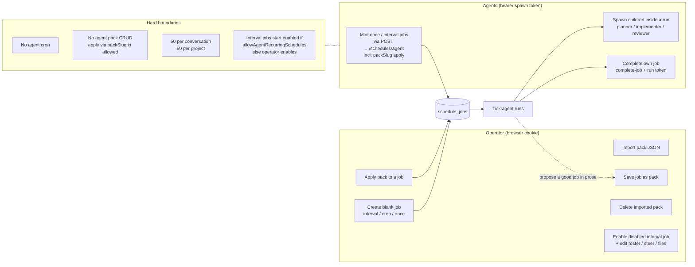
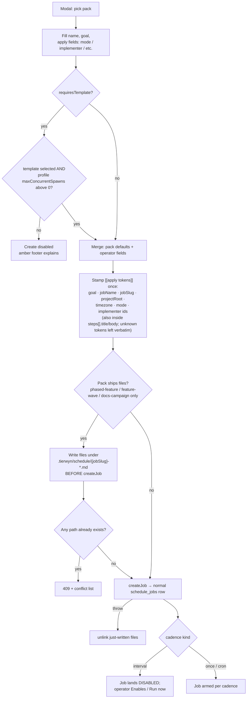
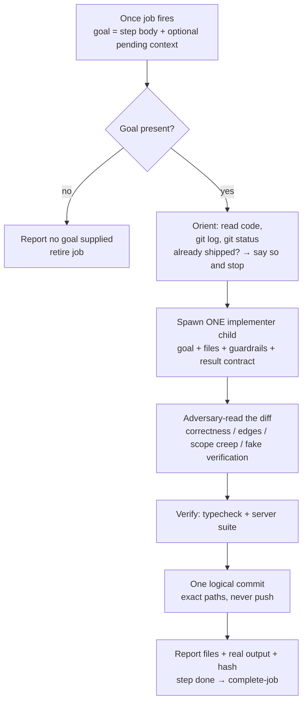
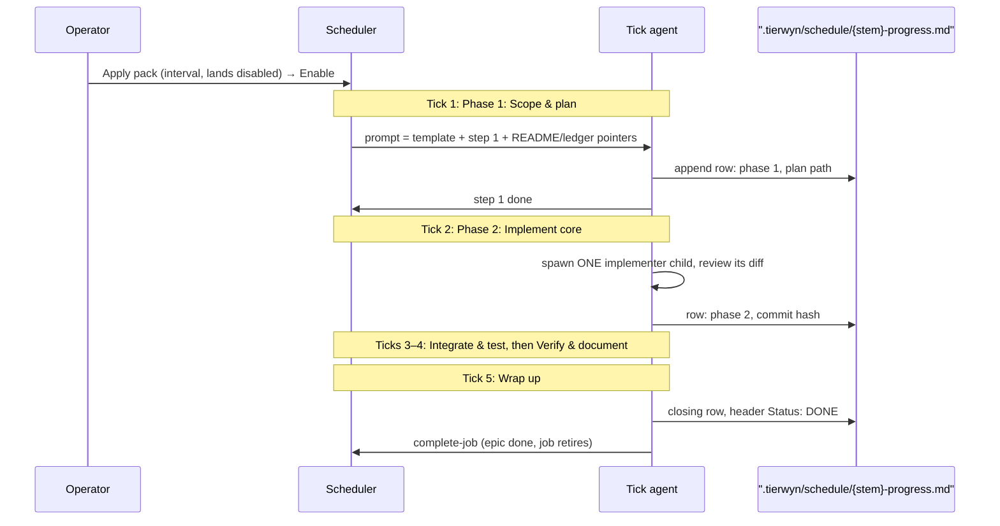
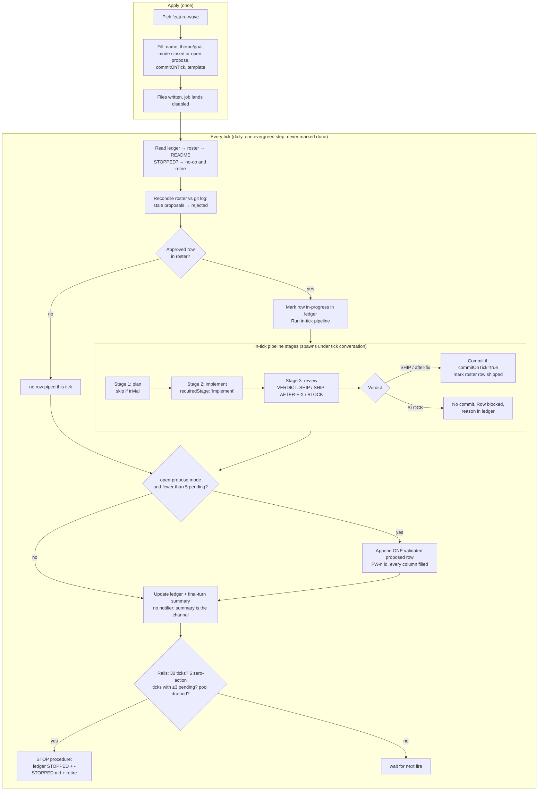
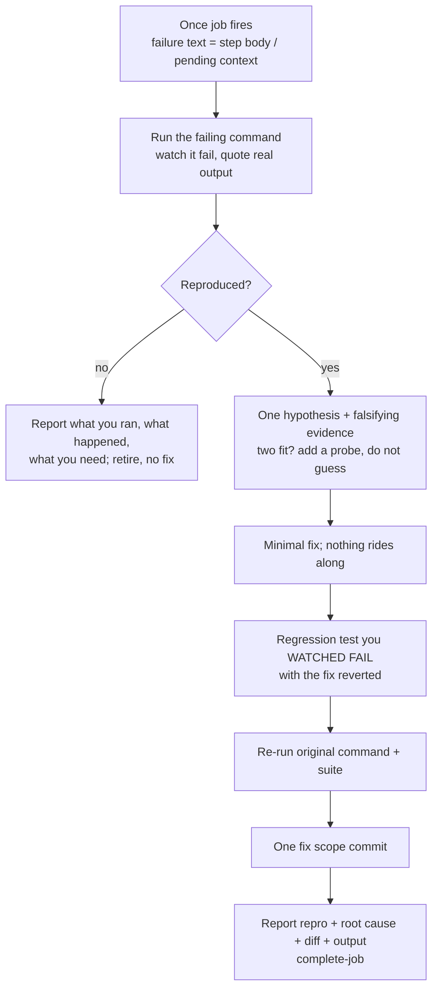
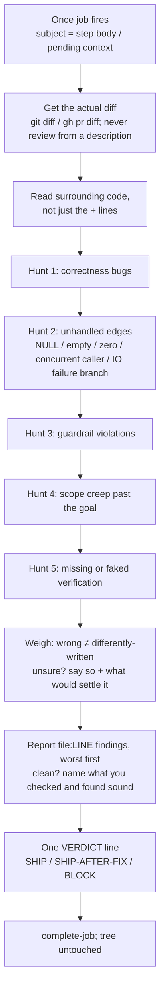
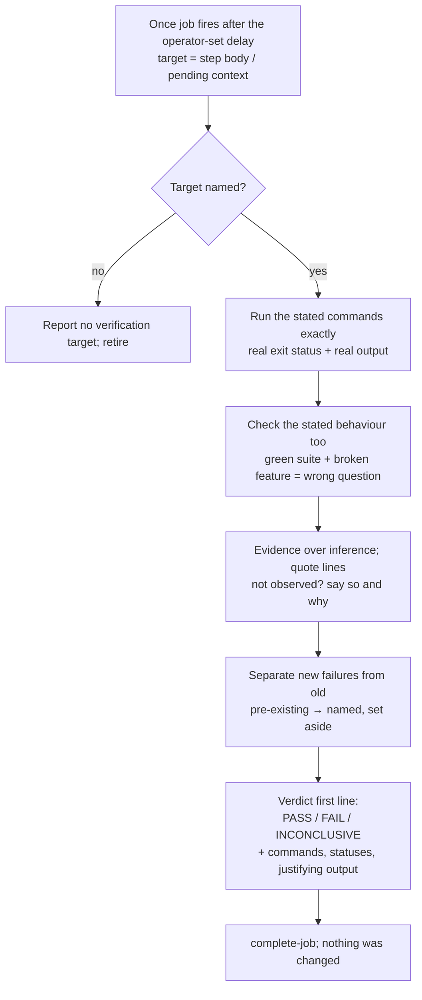

# Schedule Packs: Workflow Blueprints for Scheduled Jobs

A **schedule pack** is an instantiate-and-forget blueprint for a scheduled job: cadence, prompt
template, steps, behavioural defaults, and; for the two long-running packs; a set of markdown
policy files materialised into the repo at apply time. Applying a pack copies it into a normal
`schedule_jobs` row; the pack is never referenced again. Pack updates never touch live jobs, and
deleting a pack changes nothing about jobs already created from it.

Packs live in a **global catalogue** (Settings → Agents is where spawn caps live; the pack
picker is in the New Schedule modal). Six packs ship with the app; operators can import their own
or promote an existing job to a pack.

**Base machinery** (claim → prompt → dispatch → step API → overlap policies) is documented in
[scheduled-jobs.md](scheduled-jobs.md). This doc covers the pack layer on top of it.

**Code:**

| Piece | Path |
|---|---|
| Pack contract + import validator | `packages/shared/src/packs.ts` |
| Shipped pack definitions | `apps/server/src/schedules/packs/*.ts` |
| Pack CRUD routes (cookie-auth) | `apps/server/src/routes/schedulePacks.ts` |
| Apply (rides job create) | `apps/server/src/routes/schedules.ts` |
| Apply-time file materialisation | `apps/server/src/schedules/packFiles.ts` |
| Web modal + save-as-pack | `apps/web/src/components/Sidebar.tsx`, `apps/web/src/schedulePackForm.ts` |

---

## The automation model in one picture

Tierwyn's scheduling is deliberately asymmetric: **automation is unbounded in what a tick can think
and do, bounded in what it can leave behind.** Anything persistent; a pack, an enabled interval
job, a recurring cron; requires an operator action. This is what makes aggressive tick behaviour
safe to enable.



What this buys you in practice:

- **Agent-driven scheduling**: any agent can mint jobs for *other* agents (different profiles and
  templates): that is the entire Feature Wave mechanic (orchestrator tick → one-shot implementer
  jobs).
- **Run-to-run state**: `pendingContext` / carry-forward context is a one-shot operator→job
  channel; materialised files under `.tierwyn/schedule/` are durable job↔job state; **steer** is an
  operator-editable focus line that takes effect next tick with no redeploy.
- **Reprogramming a live job**: for file-based packs, behaviour lives in markdown the job owns
  after apply; editing the file changes the very next tick.
- **Delegation inside a tick**: full plan → implement → adversary-review pipelines run inside a
  single run via child spawns.
- **A promotion loop**: an agent's well-tuned job can become a reusable pack with one operator
  click (Save job as pack).

Honest boundaries (design, not deficits): agents cannot create cron jobs, and they cannot
create/import/delete packs, but they **can apply** a catalogue pack via `packSlug` on
`POST …/schedules/agent`. Agent-minted jobs are capped at **50 per creating conversation** and
**50 per project**; `complete-job` auto-archive (D4) recycles those slots. Recurring interval
schedules self-start when the operator has enabled `allowAgentRecurringSchedules`; otherwise they
land disabled (`pending_operator_enable`) until a human Enables / Run now. There is no sub-minute
cadence anywhere (agent once-jobs floor at 1 minute, pack intervals at 5 minutes).

---

## Applying a pack

The New Schedule modal is pack-first: pick a pack (or **Blank job**), fill the pack's fields, and
create. Apply rides the ordinary operator job-create route with `packSlug`, `goal`, and `packVars`
added; the server merges pack defaults with the operator's overrides, then creates a plain job.

**Hiding shipped packs:** the General settings toggle *Hide built-in schedule packs*
(`hideShippedSchedulePacks` in the `general` settings blob) filters `origin: 'shipped'` packs out
of the picker. Imported packs (`origin: 'imported'`) stay listed. The setting flows App → Sidebar
prop so a toggle in Settings updates the mounted picker live.



Three substitution surfaces, never interchangeable:

| Family | Written by | Substituted | Examples |
|---|---|---|---|
| `[[double brackets]]` | Pack author | **Once, at apply**: into promptTemplate, file bodies, and step titles/bodies | `[[goal]]`, `[[jobSlug]]`, `[[mode]]` |
| `{{double braces}}` | Pack author | **Every tick** by the scheduler (see scheduled-jobs.md) | `{{step.title}}`, `{{step.body}}`, `{{steps.snapshot}}`, `{{job.id}}`, `{{run.id}}` |
| `{{vars.<key>}}` | Pack author | **Every tick** from the job's `variables` map | Retunable knobs (`implementerProfileId`, `depth`, `commitMode`, …). Apply seeds any `packVars` key referenced this way so the operator can retune from Variables without rewriting the template. Identity tokens (`[[mode]]`, file paths) stay apply-time; file copies of knobs are fallback snapshots. |

The file stem `jobSlug` is derived from the **job name** (pack prefix stripped, kebab-cased, capped
at 48 chars); not from the pack slug. That is what lets the same pack be applied twice in one
repo: two waves coexist as `tierwyn-evolve-wave-*.md` and `docs-wave-*.md`.

Why jobs land disabled: a pack's interval is a standing automaton. The operator picks the moment
it comes alive (Enable, or Run now for an immediate first tick). Blank jobs created by hand still
create enabled; this behaviour is a pack-apply addition only.

### Agent pack apply

Agents holding a valid bearer token can apply packs via `POST /projects/:projectId/schedules/agent`. The body accepts `packSlug`, `packVars`, and `goal`. When an agent applies a pack:
- `templateName` is strictly pinned to the creating conversation's template (enforcing the roster lock). Mismatches fail with 400.
- Merged request seeds variables: pack `job.variables` < `packVars` < `variables`. Blank `<stage>Role` values are then auto-filled from the job template's "use when" text (keyword scoring in Settings → Schedules; `"primary"` preferred, `"secondary"` de-prioritised; opt-out phrases like "specifically" skip a delegate).
- If the pack specifies `requiredStages` (e.g. `['implement']`), the stage's role must exist in the template's roster after auto-match; otherwise rejected with 400 (`pipeline: required stage 'implement' is skipped` / `role '…' not in template`). Fix by adding a matching delegate, adjusting keywords in Settings → Schedules, or passing `<stage>Role` in pack variables.
- Non-required stages with missing roles are skipped at apply time (`role := "none"`) and surfaced in `warnings`.
- Pack files under `.tierwyn/schedule/{jobSlug}-*.md` are materialised sync before `createJob` (unlinked if creation throws).
- Enabled status follows the D3 rule: one-shots self-start; recurring interval jobs land disabled unless `allowAgentRecurringSchedules` is turned on.

---

## The seven shipped packs

| Pack | Cadence default | Steps | Files written | One-line |
|---|---|---|---|---|
| `single-pr-feature` | once, +1 h | 1 | - | One goal, one implementer child, one commit. |
| `phased-feature` | interval, daily | 5 | prompt · progress · README | One closed epic, one phase per tick. |
| `feature-wave` | interval, daily | 1 (evergreen) | prompt · progress · roster · README | Propose / approve / mint against a roster. |
| `fix-from-failure` | once, +15 min | 1 | - | Reproduce → minimal fix → regression test. |
| `pr-review` | once, +15 min | 1 | - | Adversary review of a named diff. Read-only. |
| `verify-after-change` | once, +1 h | 1 | - | Delayed verification. Report PASS/FAIL, change nothing. |
| `docs-campaign` | interval, daily | 1 (evergreen) | prompt · progress · roster · README | Eight documentation slices, one per tick, ending in a freshness check. |

All carry the same shared prose blocks (`apps/server/src/schedules/packs/shared.ts`):
**Guardrails** (never deploy, no destructive git, never clobber uncommitted `vite.config.ts` /
`ws.ts`, migrations must be registered, `git add` exact paths, no secrets), **Verify** (typecheck
+ server suite, quote real output), and **Retiring this job** (derive the complete-job URL from
the step-API footer URL; a pack apply is operator-created, so the footer does not print it
directly). `docs-campaign` is the one exception: it skips the shared **Verify** block, because a
documentation slice verifies itself with its own exit-test command, not with the server suite.

### Documentation campaign (`docs-campaign`)

Eight closed slices; inventory & verified facts, prune, tutorial, how-to guides, reference,
architecture & ADRs, troubleshooting, sweep; one per tick, `light` depth running only four of
them. Facts are extracted from code with `path:line` provenance before any prose is written; page
deletions are gated behind an `Operator` column in the roster (blank is never approval); each
slice must quote the real output of its exit-test command in the ledger. The final slice installs a
link check plus three-to-six fact assertions so the corpus is defended after the campaign stops.
`requiresTemplate: false`; doc work is reading and writing, so the pack spawns nothing.
Apply-time knobs (`archetype`, `depth`, `docsTool`, `changelogPolicy`, `commitMode`,
`implementerProfileId`) seed job **variables** and interpolate into the steer every tick, so they
can be retuned from the Schedule browser without rewriting the template.

### Single PR feature (`single-pr-feature`)

The simplest implementation unit: one goal in, one logical commit out, then the job retires
itself. The tick orients (reads the code, checks `git log`, if the goal already shipped, it says
so and stops), delegates to **exactly one** implementer child, adversary-reads the resulting
`git diff` itself, verifies, commits once with `type(scope): subject`, and reports. No schedules
minted, no chaining.



Use it for: a well-scoped change you want reviewed, verified, and landed without babysitting.

### Phased feature (`phased-feature`)

One **closed** epic delivered in five linear phases, one phase per tick on a daily interval. The
scope is fixed at apply (the `[[goal]]`); the tick never proposes new work, never mints schedules,
and spawns the implementer as a **child inside the tick**; not as a job for later. Planning-only
phases (Phase 1) need no child at all.

The five steps ship with the pack: **Scope & plan → Implement core → Integrate & test → Verify &
document → Wrap up & stop**. Edit them under *Edit steps* to re-scope mid-epic; the next tick
picks up the new text.



Blocked phases are first-class: a phase that cannot finish is marked `blocked` with the reason in
the step body **and** the ledger row; a blocked phase the operator can see beats a guessed one.
Fix the blocker, set the step back to `pending`, and the next tick retries. A tick that finds the
ledger header `Status: DONE` no-ops and retires the job rather than restarting a finished epic.

### Feature wave (`feature-wave`)

The most powerful pack: a standing orchestrator that reconciles a **roster** of feature
candidates, runs an in-tick `plan` → `implement` → `review` pipeline for rows the **operator approved**,
and; in `open-propose` mode; appends one new validated proposal per tick. It operates as a
**single-schedule pipeline**: no one-shot implementation jobs are minted (`POST …/schedules/agent` is
forbidden in wave ticks). All stages run directly under the tick conversation via child spawns.

Two modes, chosen at apply:

- **Closed pool (default)**: you paste the candidate pool into the goal; the roster is the
  operator's alone to fill. The tick works the pool: reconcile, pipe approved rows, never append.
  When the pool drains (all rows `shipped`/`rejected`, none `approved`), it STOPs rather than
  idling.
- **Open propose**: additionally, the tick may append **one** validated `proposed` row per tick
  (≤5 pending), preferring measured gaps (deferred plans, architecture TODOs) over greenfield
  invention, and rejecting at proposal time anything that widens security posture or rewrites the
  product.



The roster (`{stem}-roster.md`) is the entire approval surface: **you approve by editing a status
word**: `proposed` → `approved`. No UI, no command. The tick never sets `approved` itself; that
flip is always the operator's.

#### Pipeline variables & `{{pipeline}}`

The pipeline is configured via job variables and rendered into the tick prompt by the built-in
**`{{pipeline}}`** token. `feature-wave` declares `requiredStages: ['implement']`; at apply time,
the server strictly validates that the role assigned to `implement` exists in the chosen template's roster.

| Variable | Purpose | Default |
|---|---|---|
| `stages` | Comma-separated list of active stage IDs | `plan,implement,review` |
| `commitOnTick` | `true` to commit changes after review passes, `false` to leave uncommitted | `true` |
| `planRole` | Roster role for the `plan` stage | from template / settings |
| `implementRole` | Roster role for the `implement` stage (**required**) | from template / settings |
| `reviewRole` | Roster role for the `review` stage | from template / settings |
| `<id>Function` | Optional custom prompt / verification contract for stage `<id>` | built-in defaults |
| `mode` | Wave mode (`closed` or `open-propose`) | `closed` |

Rails (in the prompt file, hard): max **1** row piped per tick, oldest approved row first, max 1 fix
loop per row per tick; ≤5 pending proposals; forced STOP at 30 ticks; disengagement STOP after 6
consecutive zero-operator-action ticks with ≥3 pending; a review note in the ledger every 3rd
tick. Existing v2 jobs continue running unchanged; applying a new wave instantiates v3.

### Fix from failure (`fix-from-failure`)

A one-shot fix tick built around one discipline: **never fix what you have not reproduced.**



### PR review (`pr-review`)

An adversary reviewer as a scheduled job: it assumes the named diff is wrong and goes looking for
the break. Subject = a branch, commit range, PR number, or the uncommitted working tree. It is
**read-and-report only**: no code, no commits, no pushes, not even a "quick fix" of what it
finds. Findings are `path/to/file.ts:LINE` ordered by severity across five hunts: correctness
bugs, unhandled edges, guardrail violations, scope creep, missing/faked verification. Ends with
exactly one verdict line: `VERDICT: SHIP` / `SHIP-AFTER-FIX: …` / `BLOCK: …`.



### Verify after change (`verify-after-change`)

Delayed verification: something changed a while ago; does it actually work now? Observe and
report, change nothing (no edits, commits, pushes, restarts, migrations, building and testing is
fine, tree writes are not). `fireInMs` in the modal is the delay knob. Pre-existing failures get
named and set aside, not fixed.



---

## Persistent ledger files (Phased, Wave & Docs campaign)

Only `phased-feature`, `feature-wave` and `docs-campaign` materialise files, because only they
have state that must outlive a single tick. The other four packs are `promptTemplate`-body-only:
one tick, no memory needed.

At apply, before the job row is created, the server writes under `<projectRoot>/.tierwyn/schedule/`:

| Stem | Phased | Wave | Purpose |
|---|---|---|---|
| `{jobSlug}-prompt.md` | ✅ | ✅ | The policy every tick follows. The `promptTemplate` is just a pointer to it (kept under the 8 KiB ceiling). |
| `{jobSlug}-progress.md` | ✅ | ✅ | Append-only ledger: per-tick rows, statuses, minted job ids, deferred ideas. Never rewrite history; add a correcting row. |
| `{jobSlug}-roster.md` | - | ✅ | The operator's approval surface (see Feature wave above). |
| `{jobSlug}-README.md` | ✅ | ✅ | File map, mode/implementer record, operator runbook. |
| `{jobSlug}-STOPPED.md` | ✅ (by tick) | ✅ (by tick) | Written by the STOP procedure; **its presence makes every later tick a no-op.** |

`docs-campaign` writes the same four stems (plus `-STOPPED.md` by tick); its roster is the page
inventory and fact table rather than a feature roster.

Properties that matter:

- **Apply-time safety**: if any target path already exists, apply fails 409 with the conflict
  list and nothing is written; if `createJob` throws after the files are written, they are
  unlinked. No orphan quartets.
- **The job owns the files after apply.** Editing them changes the job's behaviour immediately:
  no redeploy, no reapply, no pack involvement. This is the mid-flight reprogramming surface:
  re-scope a phase under *Edit steps*, switch a wave's mode by editing the `**Active mode:**`
  line in the prompt file, change implementers (and other retunable knobs) via **Variables**.
- **Path safety by construction**: a pack file is identified by its `kind` (`prompt` /
  `progress` / `roster` / `README`), never a path; the filename is always derived from the
  job-name slug. No operator- or pack-supplied path ever reaches the filesystem, so traversal is
  impossible.
- **Ledgers are memory, not logs**: each tick reads the ledger first and reconciles it against
  `git log` (a row claiming `done` that the code contradicts gets corrected with a note, not
  trusted).

---

## Custom packs

The catalogue is not closed. Two operator-only paths add to it (both cookie-auth; agents get
401; packs are operator-curated by design, so a tick cannot escalate itself new standing
behaviour):

### Import JSON: `POST /schedule-packs`

Paste a pack document; the server validates it strictly (`validateSchedulePack`,
`packages/shared/src/packs.ts`) and stores it with `origin: 'imported'`. Document shape:

```jsonc
{
  "slug": "my-pack",                    // ^[a-z0-9][a-z0-9-]{0,47}$; also the job-name prefix
  "title": "My pack",
  "description": "What it instantiates.",
  "version": 1,
  "requiresTemplate": true,             // recipe spawns ⇒ apply needs a template + spawn-capable profile
  "profileAgentHint": "claude-code",    // preselects a matching profile; operator may override
  "job": {
    "cadence": { "kind": "interval", "everyMs": 86400000 },  // or { "kind": "once", "fireInMs": 3600000 }
                                                             // or { "kind": "cron", "expr": "0 9 * * 1" }
    "promptTemplate": "…{{step.title}} {{step.body}}… [[goal]]…",   // ≤ 8 KiB, required
    "steer": "…",                       // optional durable operator focus, ≤ 8 KiB
    "workdir": "shared",                // shared | worktree
    "overlapPolicy": "skip",            // skip | queue_one | catch_up
    "executionMode": "spawn_child",     // spawn_child | resume_conversation
    "runTimeoutMs": 3600000,
    "agentMayComplete": true,
    "steps": [ { "title": "…", "body": "…" } ]   // ≤ 5 steps
  },
  "applyFields": [                      // extra controls rendered in the apply modal
    { "key": "mode", "label": "Mode", "type": "select",
      "options": [ { "value": "a", "label": "A" } ] },
    { "key": "implementerProfileId", "label": "Implementer", "type": "profile" }
  ],
  "files": [                            // materialised under .tierwyn/schedule/{jobSlug}-*.md
    { "kind": "prompt",  "body": "# policy… [[goal]] …" },
    { "kind": "progress", "body": "…" },
    { "kind": "roster",   "body": "…" },
    { "kind": "README",   "body": "…" }
  ]
}
```

Validation limits (enforced, not advisory): pack document ≤ 256 KiB; `promptTemplate` ≤ 8 KiB;
each file body ≤ 64 KiB; ≤ 5 steps; ≤ 4 files, one per kind, no duplicates; interval ≥ 5 min;
`once` fireInMs in [1 min, 7 days]. Unknown keys are stripped; **`origin` is always forced to
`imported`**; an import can never mint a shipped row. Re-importing the same slug overwrites the
imported pack; a slug belonging to a shipped pack is refused (409).

### Save job as pack

The job form is the pack editor: tune a job (blank or applied from any pack) until it behaves,
then **Save job as pack** in the Schedule browser snapshots it; prompt template, steer, workdir,
overlap policy, execution mode, timeout, `agentMayComplete`, steps, and cadence (clamped to the
pack floors: sub-5-minute intervals clamp up, out-of-window `once` clamps into range).
`requiresTemplate` is inferred from whether the job carries a `templateName`.

Known caveat: save-as-pack captures the **prompt template only, not materialised files**. If the
job is a Phased/Wave-style job whose prompt points at `.tierwyn/schedule/{stem}-*.md`, the saved
pack keeps pointers to the *old* stem; edit the template before re-applying, or add a `files`
block by hand in the JSON.

### Deleting

`DELETE /schedule-packs/:slug` removes **imported** packs only; shipped packs answer 403.
Deleting a pack never affects jobs already created from it; they are ordinary rows, and
file-based jobs own their files outright.

---

## Permission boundaries (summary)

| Action | Operator (cookie) | Agent (bearer token) |
|---|---|---|
| Apply a pack | ✅ modal | ✅ via `POST …/schedules/agent` (`packSlug` + `packVars`) |
| Create / import / delete packs | ✅ | ❌ 401 |
| Create blank jobs | ✅ incl. cron | ✅ interval / once only |
| Mint jobs for other agents | ✅ | ✅ (capped 50/conversation, 50/project) |
| Edit steer / steps / pending context | ✅ | step writes on own run |
| Enable a disabled interval job | ✅ (requires operator consent toggle) |

### D3 Enable Rule & Recurring Consent

Agent-created schedules follow scoped activation rules:
- **One-shots (`once`):** Self-start automatically (`enabled: true`), bounded by a 7-day horizon, conversation template roster lock, and 50/50 quota caps.
- **Recurring jobs (`interval`):** Land disabled (`enabled: false`, `status: "pending_operator_enable"`) by default. Agents can only start recurring jobs if the operator has explicitly turned on `allowAgentRecurringSchedules` via the consent modal in Settings → Schedules.
- **Safe Mode override:** When spawn approval is required (`spawnApprovalRequired: true` globally or on the template), all agent-created jobs are forced disabled.

### Auto-archive on `complete-job` (D4)

When `complete-job` is called on a `once` schedule, the server automatically archives the job (`archived = 1`) if `general.autoArchiveCompletedOneShots` is enabled (default: true). This immediately frees the agent's quota slot without requiring manual operator cleanup.

Existing v2 feature-wave jobs keep running with their existing files and minted-job policy. Re-applying a wave under a new name instantiates the v3 single-schedule pipeline.
