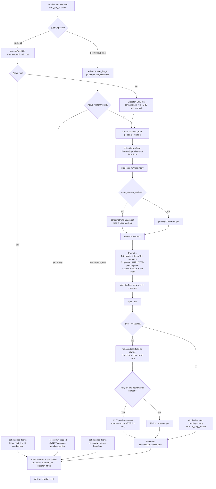
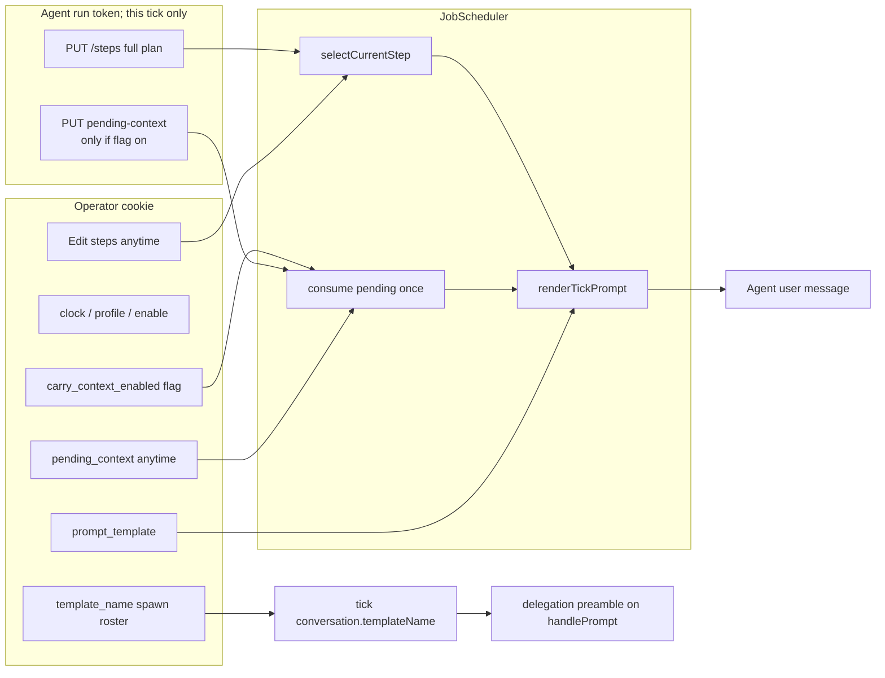

# Scheduled Jobs: Prompt Construction & Operator Edits

Project-scoped jobs fire on an interval, cron, or **once** (absolute time), advance a durable multi-step plan, and dispatch each tick through the same `handlePrompt` / spawn machinery as normal chats. This page is the authoritative description; the original design doc and plan live in the operator's private notes and are not part of this repository.

**Code:**

| Piece | Path |
|---|---|
| Tick prompt renderer | `apps/server/src/schedules/prompt.ts` → `renderTickPrompt` |
| Due-job claim + step select | `apps/server/src/schedules/jobScheduler.ts` |
| `spawn_child` dispatch | `apps/server/src/schedules/dispatch.ts` |
| REST (operator + agent step API) | `apps/server/src/routes/schedules.ts` |
| Run-token store | `apps/server/src/schedules/runTokens.ts`: 30-min **idle** TTL backstop, not a lifetime; slides on each successful step-API validation |
| Schedule browser UI | `apps/web/src/components/ScheduleBrowser.tsx` (operator **Edit steps** is a form: title / body / status / depends-on / reorder, not a raw JSON textarea; still `PUT`s the full structured step list) |

Opt-in OS / PWA notifications when a job fires, a run ends, or a `once` job auto-disables: [browser-notifications.md](browser-notifications.md). Fire and “run conversation started” are one toast.

**Workflow blueprints on top of jobs**: the six shipped schedule packs (single PR, phased feature, feature wave, fix from failure, PR review, verify after change), custom pack import, and save-job-as-pack: [schedule-packs.md](schedule-packs.md).

---

## Flow (Mermaid)

### Single tick: claim → prompt → agent → step write



### Overlap policies

Hard invariant: **no two runs of the same job are ever active concurrently.** `dispatchTick` is fire-and-forget (the run stays `running` until finalize), so backlog never bursts inside one poll.

**Why this holds without a lock:** every dispatch path checks `hasActiveRun` and then reaches `createRun` (which writes a `pending` run row) **with no `await` in between**: `runNow` and `processDueJob`/`processCatchUp`/`drainDeferred` all call straight through `dispatchNewRun` synchronously up to `createRun`. Under Node's single-threaded run-to-completion, that makes check-then-create atomic: whichever caller runs first writes the row, and the next caller's `hasActiveRun` sees it. This is why `runNow` is safe **outside** the `ticking` re-entrancy guard. ⚠️ Load-bearing: if anyone inserts an `await` between a `hasActiveRun` check and `createRun` (e.g. by making `selectCurrentStep`/`healInfraBlockedSteps` async), this guarantee breaks and two runs can race into existence for one job.

| Policy | When due and a run is already active | After the active run finishes | Concurrent runs? |
|---|---|---|---|
| `skip` | Record a `skipped` run (`error: overlap_skip`); advance `next_fire_at`; do **not** consume `pending_context` | Nothing owed | Never |
| `queue_one` | Set `deferred_fire=1` (single-bit latch); advance `next_fire_at`; **no** run row, **no** skip broadcast | Next poll's `drainDeferred` claims the latch and dispatches **exactly one** owed fire | Never; at most one deferred fire no matter how many intervals were missed while busy |
| `catch_up` | Set `deferred_fire=1`; leave `next_fire_at` **unadvanced** so the slot stays owed | Drain **one missed non-skipped slot per completed run** (processCatchUp or drainDeferred advances `next_fire_at` by one real slot per dispatch). Operator-skip holes are never catch-up candidates. Enumeration of missed slots is capped at 5 per poll (cost bound only, not a dispatch burst). | Never; a long backlog drains at roughly **one slot per run duration** |

`deferred_fire` lives in SQLite (crash-safe **at rest**). `listJobsWithDeferredFire` does **not** filter `enabled`; a `once` + `queue_one` job disables itself on the latching tick but still owes its one deferred fire.

**Delivery is at-most-once, not exactly-once.** `drainDeferred` claims the latch (`claimDeferredFire`, CAS 1→0) *before* dispatching. A process kill in the tiny synchronous window between the claim commit and `createRun` drops that single owed fire (for `queue_one`; `catch_up` self-heals from `next_fire_at ≤ now` unless the dropped slot was the last of the backlog). This is deliberate: claim-then-dispatch avoids the worse failure; a crash *after* dispatch double-firing on restart. The window is a SIGKILL/OOM between two adjacent synchronous DB writes, so it is negligible in practice but real; do not describe the latch as "never lost."

### Multi-tick plan advance (happy path)

```mermaid
sequenceDiagram
  participant Op as Operator
  participant DB as schedule_jobs / steps
  participant Sch as JobScheduler
  participant Ag as Tick agent

  Op->>DB: Create job + steps (1 ready, 2–4 pending)<br/>optional pending_context note<br/>carry enabled
  Note over Op,DB: Prompt template is standing envelope

  rect rgb(40,40,50)
    Note over Sch,Ag: Tick 1: Investigate
    Sch->>DB: Select step 1 → running
    Sch->>DB: Consume pending_context (once)
    Sch->>Ag: Prompt(template + step1 + snapshot + note)
    Ag->>Ag: Do investigation
    Ag->>DB: PUT steps: 1 done, 2 ready<br/>(refine step 2 body)
    Ag->>DB: PUT pending-context handoff for tick 2
  end

  rect rgb(40,50,40)
    Note over Sch,Ag: Tick 2: Implement
    Sch->>DB: Select step 2 → running
    Sch->>DB: Consume handoff note
    Sch->>Ag: Prompt(template + refined step2 + snapshot + note)
    Ag->>Ag: Implement + tests
    Ag->>DB: PUT steps: 2 done, 3 ready
  end

  rect rgb(50,40,40)
    Note over Sch,Ag: Tick 3: Verify
    Sch->>DB: Select step 3 → running
    Sch->>Ag: Prompt(template + step3 + snapshot)
    alt success
      Ag->>DB: PUT steps: 3 done, 4 ready
    else blocked
      Ag->>DB: PUT steps: 3 blocked + explanation
    end
  end

  Note over Op,DB: Operator can Edit steps / queue note between ticks anytime
```



### Who writes what



---

## Run timeout (`runTimeoutMs`)

`run_timeout_ms` (default **30 minutes**) is an **idle / stall budget**, not a hard wall-clock from fire.

| Signal | Counts as progress |
|---|---|
| Events on the tick conversation | yes |
| Events on open `notifyParent` spawn children | yes |
| Wall-clock age alone while children keep working | **no**: does not time out |

A multi-spawn wave that keeps producing events past 30 minutes stays `running` (amber). The run becomes `timed_out` (red) only after **no progress** for a full `runTimeoutMs`. The same rule drives in-process dispatch and `reclaimStuck` (boot / poll after OOM), so a restart cannot fail a still-active wave just because wall-clock age exceeded the budget.

Code: `apps/server/src/schedules/runActivity.ts`, wired from `dispatch.ts` + `jobScheduler.reclaimStuck`.

---

## Delegation template (multi-agent ticks)

Jobs can attach the same **spawn template** (Settings → templates / chat “Delegation template”) as normal conversations:

| Field | Notes |
|---|---|
| `schedule_jobs.template_name` | Optional. Operator-owned create/edit. |
| `schedule_jobs.capability_profile` | Stamped from the creating conversation on agent-create. NULL = `all` (operator jobs and jobs minted before the column). Applied to each `spawn_child` run conversation. |
| Tick child | On `spawn_child`, `createConversation({ templateName: job.templateName, capabilityProfile: job.capabilityProfile })` so `sessionManager` injects the roster + spawn curl block under the same plugin grant |
| Further spawns | Child inherits `template_name` via the normal spawn path (same as chat) |
| `resume_conversation` | Job field is not applied to the bound chat; set the template on that conversation directly |
| Clear | PATCH `templateName: null` |

Without a template, the tick agent is single-profile only (no autonomous delegation preamble).

---

## What a tick sends the agent

On each **non-skip** fire the server builds **one** prompt and passes it as the user message:

```
┌──────────────────────────────────────────────────────────┐
│ 1. promptTemplate                                        │  operator-owned, durable
│    with {{…}} tokens substituted                         │
├──────────────────────────────────────────────────────────┤
│ 1b. (optional) steer                                     │  durable operator focus
├──────────────────────────────────────────────────────────┤
│ 2. (optional) pending_context section                    │  one-shot note for this run
│    "Operator/parent context (this run only, UNTRUSTED…)"│  only if carry is enabled
├──────────────────────────────────────────────────────────┤
│ 3. Schedule step API footer + ephemeral run token        │  always appended by server
└──────────────────────────────────────────────────────────┘
```

There is no separate “edit next step” control. **The next work unit is the current plan step** the scheduler selects (first by ordinal with status `ready` or `pending` whose dependency, if any, is `done`). Editing that step’s title/body is how you change what the next fire does.

---

## Three knobs that shape the next tick

| Schedule browser control | What it changes | Lifetime | Lands in the tick prompt as |
|---|---|---|---|
| **Edit schedule → Prompt template** | Standing envelope every tick uses | Permanent until edited again | Section 1 body |
| **Edit schedule → Steer** | Durable focus on what to prioritize | Permanent until edited again | Section 1b (after template) |
| **Edit schedule → Variables** | Fire-time knobs interpolated as `{{vars.<key>}}` | Permanent until edited again | Substituted into template and steer on every fire |
| **Edit steps** | Durable plan: order, titles, bodies, statuses, dependencies | Sticky across ticks | Substituted into template tokens (`{{step.*}}`, `{{steps.snapshot}}`) |
| **Context for next run** | One operator/parent note for the *next* non-skip tick | **Consume-once**, then cleared | Section 2 (only if **Carry-forward context** is enabled) |

### Authorship split

| Who | Owns |
|---|---|
| **Operator** (cookie) | Clock, timezone, profile, overlap, enable, **prompt template**, **variables**, carry-forward flag, workdir, initial steps, pending note (always); `POST /projects/:projectId/schedules` stamps `created_by=operator` |
| **Agent** (run token / spawn bearer in the job tree) | **Steps only** (title/body/status/deps); may set pending context for the *following* tick **only if** carry is already on; cannot enable the flag, cannot change the template, variables, or schedule |
| **Agent create** (spawn/schedule bearer) | Narrow create path: `POST /projects/:projectId/schedules/agent`; one-shot via real `once` kind (`fireInMs` / `fireAtMs`, 1 min–7 days horizon) or interval with `everyMs ≥ 5 min`; **interval jobs always inserted `enabled=0`** (operator must enable). May set `variables` at create only; no later PATCH. No cron. Timezone forced `UTC`. Conversation always derived from the token (client conversation id ignored). |

### Agent-create caps (safe defaults: leave unless real 429 pressure)

**Agent job** = one **schedule** minted by an agent (`created_by = agent`), not a tick chat or spawn child.

| Cap | Limit | Query |
|---|---|---|
| Per **creating conversation** | **50** | `created_by_conversation_id = ? AND archived = 0` |
| Per **project** | **50** | `project_id = ? AND created_by = 'agent' AND archived = 0` |

- **Creating conversation** = the chat that held the bearer and POSTed create. **Not** the job’s home conversation, and **not** ⏱ tick children under that home (those grow unbounded; concurrent runs are still max one per job).
- Slots free when the job is **archived**. Under the D4 auto-archive rule, calling `complete-job` on a `once` schedule automatically archives it (`archived = 1`) if `general.autoArchiveCompletedOneShots` is enabled (default: true), immediately returning the quota slot. For other jobs, the operator archives via sidebar/browser. Hard **Delete** also frees a slot by destroying the job.
- **Deleting a project** deletes every schedule under it (config, steps, run history, carried context; enabled recurring jobs included) along with its conversations. The confirm modal shows the schedule count. The on-disk project folder is never deleted.
- Operator-created jobs are uncapped and do not share the 50.
- Overflow: `429` `conversation_cap` or `project_cap`.

Constants: `AGENT_JOB_CAP_CONVERSATION` / `AGENT_JOB_CAP_PROJECT` in `apps/server/src/routes/schedules.ts`. Live agent doc: `GET /agent/schedule-help` § Caps.

### Schedule kinds

| Kind | `scheduleExpr` | Next fire | Exhaustion |
|---|---|---|---|
| `interval` | `{"everyMs":N,"anchor"?:ms}` | arithmetic steps from anchor/createdAt | never |
| `cron` | `expr` (5-part) | next matching minute in job timezone | never |
| `once` | `{"atMs":ms}` | exact timestamp | disabled after fire |

**Once semantics (never double-fires):** on claim, `processDueJob` advances `next_fire_at` to the sentinel and sets `enabled=0` **before** dispatch. A crash mid-tick may skip the single fire (safe failure direction) but cannot produce a second fire. Operator **run-now** bypasses this path and does not auto-disable.

**Operator vs agent horizons:** operators may set any future `atMs` (unrestricted). Agents: resolved `atMs` must satisfy `now < atMs ≤ now + 7d`. Past `atMs` is rejected at create/PATCH (born-exhausted jobs are not allowed). Schedule browser edit form: kind `once` + native `<input type="datetime-local">`; labels show `once @ YYYY-MM-DD HH:mm UTC`.

**Agent create details**

| Topic | Behavior |
|---|---|
| Auth | Dual-auth: spawn token (depth-0 conversation in the same project) or operator cookie. Mounted pre-`requireAuth` with the step API. |
| Depth | Only `spawnPolicyDepth === 0` (roots + schedule ⏱ tick runs). Deeper children → `403 depth_not_allowed`. |
| Approval / enable | **Scoped enable rule (D3):** Agent-created `once` (one-shot) jobs self-start (`enabled: true`), bounded by 7-day horizon, conversation template roster lock, and 50/50 quota caps. `interval` (recurring) jobs land disabled (`enabled: false`, `status: "pending_operator_enable"`) unless the operator explicitly enabled `allowAgentRecurringSchedules` via the consent modal in **Settings → Schedules**. Safe mode (`spawnApprovalRequired: true`) always forces `enabled: false`. |
| Authorship columns | `created_by` (`operator` \| `agent`), `created_by_conversation_id`. |
| One-shot (`once`) | `fireInMs: N` → `scheduleKind:'once'`, `{"atMs": now+N}`; `fireAtMs: N` → `once` with that absolute `atMs`. **365d interval hack removed.** `agentMayComplete` forced true. |
| Interval | Genuine recurrence only: `everyMs ≥ 5 min` (`AGENT_MIN_INTERVAL_MS`). Land disabled unless operator enabled recurring schedules. |
| Discoverability | Short preamble pointer (depth-0) + loopback-only `GET /agent/schedule-help` (markdown). **`/agent` is not in Vite `HTTP_ROUTES`**, that omission is the real remote-browser guarantee; raw-socket loopback check is defense-in-depth. |
| Tick footer | Agent-created jobs with `agentMayComplete` get a creator note + `complete-job` URL in the step-API footer. |

---

## Template tokens

Substituted by `applyTemplateSubstitutions` in `prompt.ts`:

| Token | Source |
|---|---|
| `{{step.title}}` | Selected current step’s title (empty string if no step) |
| `{{step.body}}` | Selected current step’s body |
| `{{steps.snapshot}}` | Numbered list of all steps with statuses, e.g. `1. Pull data (done)` |
| `{{pipeline}}` | Formatted markdown table of active pipeline stages from `variables` (`stages`, `commitOnTick`, `<id>Role`, `<id>Function`), rendered with stage id, role, function, and commit policy |
| `{{job.id}}` / `{{job.name}}` | Job row |
| `{{run.id}}` | This fire’s `schedule_runs` id |
| `{{vars.<key>}}` | Per-job `variables` map (string values). Unknown keys are left **literal** (`{{vars.foo}}`). Values are not re-scanned. |

Example template:

```text
Do step: {{step.title}}
{{step.body}}

Full plan:
{{steps.snapshot}}
```

On fire, if the selected step is “Merge PR #12” / “Land the checkpoint fix”, the body becomes:

```text
Do step: Merge PR #12
Land the checkpoint fix

Full plan:
1. Investigate (done)
2. Merge PR #12 (running)
3. Document (pending)
```

…then optionally the pending-context block, then the step-API footer.

**Simple recurring message:** one evergreen step that is never marked `done` (status stays `ready`/`pending` after each run if you re-open it, or use a single step the agent leaves ready). Each tick re-runs the same template with the same step body unless you edit it.

## Variables (`{{vars.*}}`)

A per-job mutable string map, set at create (operator **or** agent) and edited later by the operator only. Interpolated on **every fire** by `applyTemplateSubstitutions` into `promptTemplate` **and** `steer`. Step `title`/`body` are values, not templates; they are not scanned.

| Rule | Limit |
|---|---|
| Keys | `[a-zA-Z_][a-zA-Z0-9_]*`, no dots, ≤ 64 chars, ≤ 32 keys |
| Values | strings only (no coercion); ≤ 2 KiB each; ≤ 8 KiB serialised JSON |
| Unknown token | left literal; same as unknown pack `[[token]]` |
| Secrets | **never**: plaintext SQLite and rendered into transcripts. Use the plugin vault. |

**`[[pack]]` vs `{{vars}}`:** pack `[[token]]` substitution is **apply-time** (`substitutePackTokens` in `packFiles.ts`); tokens are baked into the stored prompt/files and then gone. `{{vars.*}}` is **fire-time** and stays on the job so the operator can retune without rewriting the template. Applying a pack seeds `variables` for any `packVars` keys referenced as `{{vars.*}}` in its templates (e.g. `feature-wave`'s `implementerProfileId`, `docs-campaign`'s `depth` / `commitMode`), merged with any operator-supplied variables, so pack knobs remain editable afterwards while apply-time tokens (like `[[mode]]`) are not duplicated into the variable map.

PATCH replaces the whole object (`null` or `{}` clears). Agents cannot PATCH variables after create; the step API rejects a `variables` field.

---

## “Edit next step” in practice

### Change the work unit for the next fire (durable)

1. Open the job → **Edit steps**
2. Edit the upcoming step’s `title` / `body`
3. Keep its status `pending` or `ready` (and dependencies satisfied)

On the next tick, `{{step.title}}` / `{{step.body}}` pull the updated text. You do **not** need pending context for this.

### One-off nudge without rewriting the plan

1. Enable **Carry-forward context** (operator-only checkbox)
2. Write under **Context for next run** and Save  
   UI badge: “Will be included in next run” when a note is queued
3. Next non-skip tick appends it as an **UNTRUSTED** guidance section, then **clears** it

Rules:

- Last write wins
- Max 8 KiB; oversize → `400 pending_context_too_large`
- **Skipped** overlap fires do **not** consume the note (it stays queued)
- Failed / timed-out runs still consume it if the tick *started*; it does not re-inject unless someone writes again
- Not a substitute for steps; not automatic transcript piping

### Change standing instructions for every future fire

**Edit schedule → Prompt template.** Independent of step bodies and pending context.

---

## Tick lifecycle (prompt-relevant steps)

1. Job due (`enabled` and `next_fire_at <= now`); advance `next_fire_at`.
2. If an active run exists and policy is `skip` (default): record skipped run, **do not** consume pending context, stop.
3. Create `schedule_runs`; select current step → mark `running`.
4. If `carry_context_enabled`, **consume** `pending_context` (atomic clear, return text).
5. `renderTickPrompt({ promptTemplate, job, step, steps, runId, stepApiBase, runToken, pendingContext })`.
6. Dispatch (`spawn_child` under job home, or `resume_conversation` into bound chat).
7. On turn end: if the agent never updated steps, move step `running` → `blocked` with reason `no_step_update`. Optionally the finishing agent may **set** a new pending note for the *next* tick when carry is on.

Footer always tells the agent how to `GET`/`PUT` `/schedules/:jobId/steps` with the run token (and not invent schedule fields). **Status guidance is conditional:**

| Tick state | Footer guidance |
|---|---|
| Current step selected | Mark that step `done` / leave next `ready`/`pending`, or `blocked` |
| No steps at all | No mark-done language; standing prompt is enough; optional PUT to seed a plan |
| Steps exist but none ready/pending | No mark-done; may re-open or add work via PUT |

---

## Mental model

```
promptTemplate  ──► recurring envelope (operator)
       │
       ├── {{step.title}} / {{step.body}}  ◄── durable plan row (Edit steps)
       ├── {{steps.snapshot}}              ◄── whole plan + statuses
       │
pending_context ──► optional one-shot side note (next non-skip tick only)
footer           ──► “you may rewrite steps via PUT …/steps”
```

**Edit steps** changes what the plan *is*.  
**Prompt template** changes how that plan is *phrased into a prompt*.  
**Context for next run** is a temporary sticky note on top of both; not the step itself.

---

## Is carry-forward static?

**No; the held note is mutable. The on/off flag is not (for agents).**

| Field | Who can change | Behaviour |
|---|---|---|
| `carry_context_enabled` | **Operator only** (cookie `PUT …/pending-context` with `carryContextEnabled`) | Default **off**. When off, the whole feature is inert: held text is ignored at tick time and agent writes get **403**. |
| `pending_context` text | **Operator always**; **agent** (run token or spawn bearer in the job tree) **only when carry is on** | Last write wins. Source stamped as `operator` \| `run` \| `system`. Max 8 KiB. |
| Consume | **JobScheduler only**, at non-skip tick **start** | Atomic clear + return previous text for injection. Skip-overlap does not consume. |

So carry-forward is:

- **Not** a fixed string baked into the job forever
- **Not** auto-filled from the previous run’s transcript
- A **mailbox** for one next tick: whoever last wrote the note (operator UI or agent `PUT /schedules/:jobId/pending-context`) determines what that tick sees; after start it is empty until someone writes again

**Caveat for agents:** the tick prompt footer documents the **step** API only. It does **not** currently list the pending-context endpoint. An agent will only set carry-forward if the operator’s `promptTemplate` (or other instructions) tells it to, or if it already knows the API:

```http
PUT /schedules/:jobId/pending-context
Authorization: Bearer <run-token>
Content-Type: application/json

{ "text": "Next tick: prefer the worktree branch, skip deploy" }
```

Clear for next tick: `{ "text": null }`. Agents cannot pass `carryContextEnabled`.

---

## Example multi-tick flow

### Setup (operator)

Job: **Ship checkpoint fix**  
Schedule: every 1h, `spawn_child`, overlap `skip`, carry-forward **enabled**  
Profile: Claude Code Opus  

**Prompt template** (envelope, same every tick):

```text
You are advancing a scheduled plan for {{job.name}} (run {{run.id}}).

Current step: {{step.title}}
{{step.body}}

Plan snapshot:
{{steps.snapshot}}

Do only the current step. When finished, PUT the full steps list with this step
"done" and the next "ready". If blocked, set status "blocked" with a clear body.
If useful for the *next* fire only, PUT pending-context with a short handoff note
(carry is enabled). Do not change the schedule itself.
```

**Initial steps** (Edit steps / create form):

| # | title | body | status |
|---|---|---|---|
| 1 | Investigate | Find why checkpoint restore diverges on worktrees | `ready` |
| 2 | Implement fix | Patch restore path; add regression test | `pending` |
| 3 | Verify | Run server tests for checkpoint; summarise | `pending` |
| 4 | Document | Update architecture note with the fix | `pending` |

Optional: operator queues **Context for next run**:  
`Prefer apps/server/src/git/shadowCheckpoint.ts; prod is live; no force-push.`

### Tick 1 (e.g. 09:00)

1. Scheduler selects step 1 (`ready`) → marks `running`.
2. Consumes pending note (if any) → injects as UNTRUSTED section → clears mailbox.
3. Agent receives template with `{{step.title}}` = Investigate, snapshot of all four steps, plus note + footer + run token.
4. Agent does investigation work in the run conversation (and may spawn children).
5. Before finishing, agent **rewrites steps** (full ordered list):

```json
{
  "steps": [
    { "id": "…s1", "title": "Investigate", "body": "…", "status": "done" },
    {
      "id": "…s2",
      "title": "Implement fix",
      "body": "In shadowCheckpoint.ts, treat worktree path as canonical. Test: restore after wt create. Files: apps/server/src/git/shadowCheckpoint.ts, shadowCheckpoint.test.ts",
      "status": "ready"
    },
    { "id": "…s3", "title": "Verify", "body": "…", "status": "pending" },
    { "id": "…s4", "title": "Document", "body": "…", "status": "pending" }
  ]
}
```

Note how step 2’s **body was refined** with concrete files, that is the main way agents “edit the next step” for the following fire.

6. Optionally agent also:

```json
PUT /schedules/:jobId/pending-context
{ "text": "Investigation: divergence is path comparison; start at isGitRepo vs workdir_path." }
```

7. Run ends `succeeded`. If the agent had **not** PUT steps while step 1 was still `running`, finalize would force step → `blocked` with `no_step_update`.

**After tick 1 plan:**

| # | status | note |
|---|---|---|
| 1 Investigate | `done` | |
| 2 Implement fix | `ready` | body updated by agent |
| 3–4 | `pending` | |
| pending_context | handoff note from agent (or empty if none written) | |

### Tick 2 (10:00)

1. Selects step 2 → `running`.
2. Consumes agent’s handoff note into the prompt; mailbox empty again.
3. Agent implements fix + tests, then PUT steps: step 2 `done`, step 3 `ready` (may rewrite step 3 body with exact test command).
4. May leave a new pending note for tick 3, or leave mailbox empty.

### Tick 3 (11:00)

Same pattern on **Verify**. If tests fail, agent might:

- Set step 3 `blocked` with body explaining the failure, **or**
- Insert/reorder steps (e.g. add “Fix flaky test” as a new ready step) via full PUT replacement

Operator sees statuses in the Schedule browser; can manually Edit steps or queue a pending note between fires.

### Tick 4 (12:00)

**Document** step. Agent marks it `done`. If `agent_may_complete` is true, agent may soft-disable the job via `POST …/complete-job`; otherwise the clock keeps firing but `selectCurrentStep` finds **no** ready/pending step → tick can still run with empty `{{step.*}}` unless the template/agent re-opens work. In practice: operator disables the job or agents re-plan with new pending steps.

---

## How the agent manipulates steps (API)

During a tick the footer (and run token) allow:

The run token is a 30-min **idle** TTL backstop, not a lifetime: each successful step-API call slides the window; an unused token dies at 30 minutes.

```http
GET  /schedules/:jobId/steps
PUT  /schedules/:jobId/steps
Authorization: Bearer <run-token>
Content-Type: application/json

{
  "steps": [
    { "id": "<keep existing id when possible>", "title": "…", "body": "…", "status": "done|ready|pending|blocked|skipped|running", "dependsOnStepId": null }
  ]
}
```

**Semantics that matter:**

- **Full ordered replacement**: not a partial patch of one field. Send the whole plan.
- Prefer **keeping `id`s** so run history and deps stay stable; omitting ids creates new rows.
- Status values: `pending` \| `ready` \| `running` \| `done` \| `blocked` \| `skipped`
- **Completion convention:** current → `done`; next work unit → `ready` or `pending`
- **Blocked:** cannot proceed; operator-visible; job stays enabled and will re-select a ready/pending step later (if any)
- **Cannot** change via this API: cron, profile, overlap, enable, template, workdir, carry flag
- Soft pause: `POST /schedules/:jobId/pause-request` blocks the running step and stamps the run; does not disable the job

**What the agent should change on each successful tick:**

1. Mark the step it just finished `done` (and optionally enrich its body with what was done).
2. Ensure the **next** unit of work is `ready`/`pending` with a **clear body** (this is the durable “next step” for the following fire).
3. Optionally rewrite later steps’ bodies as the plan becomes clearer.
4. Optionally (if carry on and template teaches it) leave a **one-shot** pending-context note for nuance that does not belong in the plan table.

---

## Carry-forward vs step body: when to use which

| Situation | Prefer |
|---|---|
| “Next fire should implement X in file Y” | **Step body** (durable, visible in plan snapshot every tick until done) |
| “Today only: deploy is frozen, skip that part” | **pending_context** (one-shot; gone after next fire) |
| Standing rules every fire | **prompt_template** |
| Current priority / focus area (durable) | **steer** |
| Multi-step re-plan mid-job | **PUT steps** full rewrite |

Pending context is a **side channel** for ephemeral guidance. The plan table is the **source of truth** for what gets selected and substituted into `{{step.*}}`.

---

## Execution modes

Every job has an `executionMode` chosen at create time. It is **immutable** after create (PATCH with a different value → `400 executionMode is immutable`; restating the same value is a no-op).

| Mode | What fires | Conversation |
|---|---|---|
| `spawn_child` (default) | Creates a new child under the job's `schedule_home` and runs the tick there | Ephemeral run chats under the Schedules tree |
| `resume_conversation` | Prompts an existing **bound** conversation in place | Operator chat or Remote Agents Bot conversation stays on the Projects tab |

**`inherit` profile** (`profileId: "inherit"`) is only valid with `resume_conversation`. On each fire the scheduler uses the bound conversation's last session `agentModelId`. The create/edit UI offers it as "Conversation's last agent".

**Busy bound chat:** if the bound conversation already has an in-flight session when a resume job fires, the run is recorded as `skipped` with `error: bound_conversation_busy`. There is no queueing; the next tick retries. Bound chats are **never purged** on job delete and **never hidden** from the Projects tab (they are ordinary conversations, not schedule run children).

**Prompt label:** resume (and spawn) ticks stamp `schedule: { jobId, jobName, runId }` on the prompt event so the UI can show a **⏰ \<jobName\>** label on the user card.

**Remote hosts:** create-time availability, fire-time `host_disconnected` + 3-miss auto-disable, and pack-file materialisation on the node are documented under [Schedules on remote hosts](remote-hosts.md#schedules-on-remote-hosts).

**Bare-prompt agents** (today: Grok Bot) reject packs, delegation templates, plan steps, worktree workdir, and `agentMayComplete` at create/PATCH (`code: bare_prompt_unsupported`). Their tick prompt is operator text only; no step-API footer and no run token. See [Scheduling a Bot](grok-bot-watcher.md#scheduling-a-bot).
