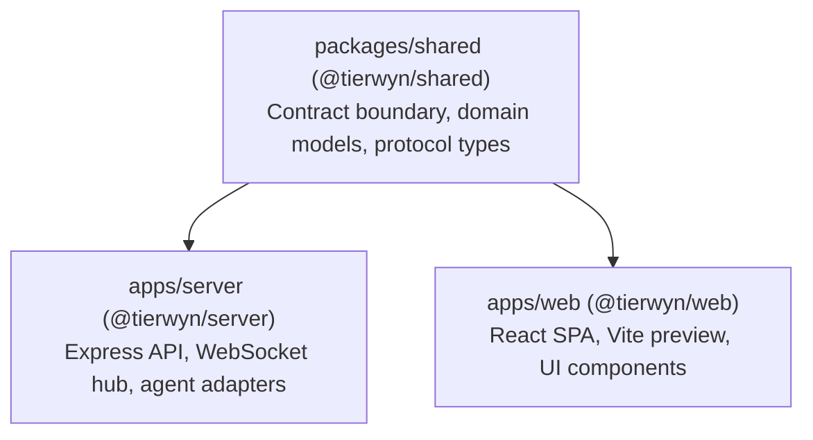

# Monorepo Package Reference

<!-- GENERATED FILE: Do not edit directly. Run 'npm run docs:generate-reference' to regenerate. -->

This document provides the reference manual for all workspaces in the Tierwyn monorepo, their dependency topology, build sequence, and exported interface boundaries.

## Workspace Topology & Build Order

Tierwyn uses npm workspaces with strict layer separation. Upstream contracts live in `packages/shared`, and downstream applications consume them.



### Build Sequence

Because `apps/server` and `apps/web` compile against the emitted JavaScript and TypeScript declaration files of `packages/shared`, `packages/shared` must always be built first:

1. **Phase 1 (Contract Core):** `npm run build --workspace=packages/shared` (emits `dist/` with `index.js` and `index.d.ts`)
2. **Phase 2 (Applications):** `npm run build --workspace=apps/server` and `npm run build --workspace=apps/web` (concurrent or sequential)

Full monorepo build command:
```bash
npm run build
```

---

## Workspace Inventory

| Workspace Path | Package Name | Version | Role | Output Target |
|---|---|---|---|---|
| `apps/server` | `@tierwyn/server` | `0.1.0` | Backend Express API, WebSocket dispatcher, adapter execution | `dist/index.js`, `dist/db/migrations/` |
| `apps/web` | `@tierwyn/web` | `0.1.0` | Frontend single-page application and UI interface | `dist/` (client bundle) |
| `packages/shared` | `@tierwyn/shared` | `0.1.0` | Shared protocol, types, domain models, event contracts | `dist/index.js`, `dist/index.d.ts` |

---

## Per-Package Reference

### `@tierwyn/server` (`apps/server`)

- **Path:** `apps/server`
- **Type:** `module`
- **Entry Point (main):** `./dist/index.js`

#### Scripts

| Script | Command | Purpose |
|---|---|---|
| `dev` | `tsx watch src/index.ts` | Run with `npm run dev --workspace=apps/server` |
| `build` | `tsc && cp -r src/db/migrations/*.sql dist/db/migrations/ && cp src/piper-voices.json dist/ && node ../../scripts/package-node.mjs` | Run with `npm run build --workspace=apps/server` |
| `typecheck` | `tsc --noEmit` | Run with `npm run typecheck --workspace=apps/server` |
| `start` | `node dist/index.js` | Run with `npm run start --workspace=apps/server` |
| `node` | `node dist/node/main.js` | Run with `npm run node --workspace=apps/server` |
| `test` | `vitest run` | Run with `npm run test --workspace=apps/server` |
| `test:watch` | `vitest` | Run with `npm run test:watch --workspace=apps/server` |

#### Internal & External Dependencies

- **Runtime Dependencies:** `@anthropic-ai/claude-agent-sdk`, `@tierwyn/shared`, `argon2`, `better-sqlite3`, `cookie`, `croner`, `dotenv`, `express`, `gpt-tokenizer`, `multer`, `web-push`, `ws`
- **Dev Dependencies:** `@types/better-sqlite3`, `@types/cookie`, `@types/express`, `@types/multer`, `@types/node`, `@types/web-push`, `@types/ws`, `esbuild`, `tsx`, `typescript`, `vitest`

#### Registered Agent Adapters

Adapter keys are registered in `apps/server/src/index.ts` via `registry.register(...)`. Keys with a dedicated package directory live under `apps/server/src/adapters/`:

- `antigravity` (`apps/server/src/adapters/antigravity/`)
- `claude-code` (`apps/server/src/adapters/claude-code/`)
- `codex` (`apps/server/src/adapters/codex/`)
- `copilot` (`apps/server/src/adapters/copilot/`)
- `cursor` (`apps/server/src/adapters/cursor/`)
- `deepseek` (`apps/server/src/adapters/deepseek/`)
- `grok-bot` (`apps/server/src/adapters/grok-bot/`)
- `grok-build` (`apps/server/src/adapters/grok-build/`)
- `hermes` (`apps/server/src/adapters/hermes/`)
- `kimi` (`apps/server/src/adapters/kimi/`)
- `kiro` (`apps/server/src/adapters/kiro/`)
- `openclaw` (`apps/server/src/adapters/openclaw/`)
- `opencode` (`apps/server/src/adapters/opencode/`)
- `pi` (`apps/server/src/adapters/pi/`)
- `qwen` (`apps/server/src/adapters/qwen/`)

---

### `@tierwyn/web` (`apps/web`)

- **Path:** `apps/web`
- **Type:** `module`

#### Scripts

| Script | Command | Purpose |
|---|---|---|
| `dev` | `vite` | Run with `npm run dev --workspace=apps/web` |
| `build` | `tsc && vite build` | Run with `npm run build --workspace=apps/web` |
| `typecheck` | `tsc --noEmit` | Run with `npm run typecheck --workspace=apps/web` |
| `preview` | `vite preview` | Run with `npm run preview --workspace=apps/web` |
| `test` | `vitest run` | Run with `npm run test --workspace=apps/web` |

#### Internal & External Dependencies

- **Runtime Dependencies:** `@codemirror/lang-javascript`, `@codemirror/lang-markdown`, `@codemirror/lang-python`, `@codemirror/language`, `@tierwyn/shared`, `@lezer/highlight`, `abcjs`, `codemirror`, `cronstrue`, `html-to-image`, `katex`, `mermaid`, `react`, `react-dom`, `react-markdown`, `rehype-highlight`, `rehype-katex`, `remark-gfm`, `remark-github-blockquote-alert`, `remark-math`, `remark-smartypants`, `unist-util-visit`
- **Dev Dependencies:** `@types/katex`, `@types/react`, `@types/react-dom`, `@vitejs/plugin-react`, `typescript`, `vite`, `vitest`

---

### `@tierwyn/shared` (`packages/shared`)

- **Path:** `packages/shared`
- **Type:** `module`
- **Entry Point (main):** `./dist/index.js`
- **Type Declarations (types):** `./dist/index.d.ts`

#### Scripts

| Script | Command | Purpose |
|---|---|---|
| `build` | `tsc` | Run with `npm run build --workspace=packages/shared` |
| `typecheck` | `tsc --noEmit` | Run with `npm run typecheck --workspace=packages/shared` |
| `dev` | `tsc --watch` | Run with `npm run dev --workspace=packages/shared` |
| `test` | `vitest run` | Run with `npm run test --workspace=packages/shared` |

#### Internal & External Dependencies

- **Runtime Dependencies:** _none_
- **Dev Dependencies:** `@types/node`, `typescript`, `vitest`

#### Exported Module Surface

All public types and domain helpers are re-exported via `packages/shared/src/index.ts`:

| Module | Source File | Description |
|---|---|---|
| `events` | `packages/shared/src/events.ts` | Exports 24 top-level symbols. |
| `agentNames` | `packages/shared/src/agentNames.ts` | Canonical display names for agent types. Single source of truth for turning a lowercase agentType slug (e.g. 'grok-build') into the human-facing label (e.g. 'Grok Build'). Lives in shared because the DB seed (apps/server/src/db/seed.ts) runs BEFORE the adapter registry is populated at boot, so it cannot read labels from the registry. Keep this in sync with the `label` passed to registry.register() in apps/server/src/index.ts. |
| `profiles` | `packages/shared/src/profiles.ts` | Exports 32 top-level symbols. |
| `adapter` | `packages/shared/src/adapter.ts` | Exports 9 top-level symbols. |
| `protocol` | `packages/shared/src/protocol.ts` | Exports 116 top-level symbols. |
| `domain` | `packages/shared/src/domain.ts` | Exports 168 top-level symbols. |
| `notifications` | `packages/shared/src/notifications.ts` | Exports 4 top-level symbols. |
| `ttsSpeak` | `packages/shared/src/ttsSpeak.ts` | Shared TTS speak helpers; used by the web client and the server speak-record pipeline so code as-is / summarize-fallback notices stay identical. |
| `paths` | `packages/shared/src/paths.ts` | Single source of truth for which file extensions count as "openable" in agent output, and the regex that finds their paths in free text. The server's file route re-uses these lists so the client and server never drift on what's considered an image vs a markdown file. |
| `usage` | `packages/shared/src/usage.ts` | Token-usage math shared across adapters and the usage route. Pure functions only; no I/O, so they're trivially unit-testable. |
| `usageLimits` | `packages/shared/src/usageLimits.ts` | One quota-language regex shared by the claude-code adapter (benign-interrupt exclusion) and the usage-watcher (layer-1 arming). Adapters must not grow private copies; add quota language here once and every consumer sees it. The cursor adapter deliberately keeps its own narrower fatal-stderr regex (broad quota words like "credit" would latch its first-match fatal detection on harmless chatter, see [S2-3]). |
| `annotate` | `packages/shared/src/annotate.ts` | Point in image-space (natural pixels). |
| `btw` | `packages/shared/src/btw.ts` | Exports 4 top-level symbols. |
| `spawnPolicy` | `packages/shared/src/spawnPolicy.ts` | Exports 4 top-level symbols. |
| `timezone` | `packages/shared/src/timezone.ts` | Curated IANA zones; shown first in the picker; full list via supportedValuesOf when available. |
| `elapsed` | `packages/shared/src/elapsed.ts` | Compact wall-clock elapsed for spawn wait/result cards: `12s`, `1m 14s`, `1h 02m`. |
| `shell` | `packages/shared/src/shell.ts` | Fixed-base allow-list. A rule is a token array; an argv is permitted iff it starts with (deep-equals prefix) some rule. Single token = trust the whole read-only binary; multi-token = restrict a multi-tool to a read subcommand. INVARIANT (enforced in server gate + per-project add): never a shell/interpreter. |
| `version` | `packages/shared/src/version.ts` | Exports 2 top-level symbols. |
| `conversationTags` | `packages/shared/src/conversationTags.ts` | FW-15; conversation tags. The single source of truth for tag validation. Both the server PATCH route (authoritative) and the web Edit modal (pre-flight UX) call normaliseTags. Keeping one implementation here is the only way the two stay honest about the same caps. Storage is a JSON array in conversations.tags (TEXT NOT NULL DEFAULT '[]'); there is deliberately no SQL CHECK constraint: SQLite json checks are fussy and this function is the guard. |
| `conversationDesignation` | `packages/shared/src/conversationDesignation.ts` | Conversation designation; one optional function chip per conversation. Built-ins live in code (undeletable). Customs live in settings and are capped. Spawn and PATCH only pick from the combined catalogue; a stored token may outlive a deleted custom so old chips keep showing. |
| `conversationTagCatalogue` | `packages/shared/src/conversationTagCatalogue.ts` | Jev auto-tag catalogue; the tags Jev may apply, each with a hint that becomes the "true" criterion of its question. Built-ins live in code (disable-able, never deletable). Customs live in the `conversation_tag_catalogue` settings row and are capped. Tag text goes through normaliseTags so the tag rules have a single source of truth. |
| `conversationTimers` | `packages/shared/src/conversationTimers.ts` | Per-conversation prompt timers: a prompt scheduled to be delivered back into its OWN conversation at a future moment, exactly as if the operator had typed it. NOT a schedule_jobs row; timers never appear in the Schedules tab. |
| `packs` | `packages/shared/src/packs.ts` | Exports 19 top-level symbols. |
| `promptCollection` | `packages/shared/src/promptCollection.ts` | Exports 15 top-level symbols. |
| `promptPack` | `packages/shared/src/promptPack.ts` | Exports 8 top-level symbols. |
| `plugins` | `packages/shared/src/plugins.ts` | Plugin system contract (phase 2). Shared between the server host and (type-only) plugin authors. `credentials.source()` is `'vault' | 'env'`. |
| `scheduleVars` | `packages/shared/src/scheduleVars.ts` | Per-job fire-time knobs. Interpolated as {{vars.<key>}} on every tick. Shared so the agent parser, operator routes, and the edit-modal pre-check cannot drift. String values only; this is a trust boundary an agent writes to. |
| `gitWorkingTree` | `packages/shared/src/gitWorkingTree.ts` | Exports 31 top-level symbols. |
| `system` | `packages/shared/src/system.ts` | Host + process resource snapshot from `GET /system/resources`. Raw kernel counters only; all percentages and human formatting are derived client-side (see apps/web/src/components/connectionQuality.ts). |
| `promptOptions` | `packages/shared/src/promptOptions.ts` | Per-message prompt options descriptor and validation system. Ephemeral per-turn CLI flags/options for agent adapters (Antigravity first). |
| `sandbox` | `packages/shared/src/sandbox.ts` | Exports 23 top-level symbols. |
| `pipeline` | `packages/shared/src/pipeline.ts` | Exports 15 top-level symbols. |
| `capabilityProfiles` | `packages/shared/src/capabilityProfiles.ts` | Capability profiles; a conversation-scoped grant over plugin capabilities and the usage-telemetry surface. Pure module: no I/O, shared by server and web. See docs/architecture/plugins.md ("Capability profiles"). |
| `globalTasks` | `packages/shared/src/globalTasks.ts` | Exports 12 top-level symbols. |
| `fileBrowser` | `packages/shared/src/fileBrowser.ts` | Exports 3 top-level symbols. |
| `mcp` | `packages/shared/src/mcp.ts` | Tierwyn-managed MCP server registry; shared contract (phase 1). Guide: docs/architecture/mcp-servers.md. Secret values never cross this boundary. |
| `operatorRules` | `packages/shared/src/operatorRules.ts` | Operator-rules composition (v1 custom blocks + stackable presets). Shared so the server preamble and the web live preview stay identical. |
| `node` | `packages/shared/src/node.ts` | Exports 78 top-level symbols. |
| `memory` | `packages/shared/src/memory.ts` | Exports 14 top-level symbols. |
| `subtreeTime` | `packages/shared/src/subtreeTime.ts` | Exports 2 top-level symbols. |

---

